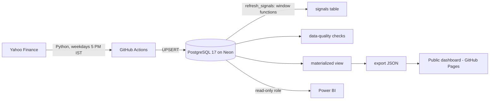

# NSE Sector Intelligence: a self-updating market database

[](https://github.com/Bhavex/market-intelligence-pg/actions/workflows/daily_update.yml)
[](https://github.com/Bhavex/market-intelligence-pg/actions/workflows/site.yml)

**Live dashboard → https://bhavex.github.io/market-intelligence-pg/**

A PostgreSQL database of 25 NSE large-cap stocks across 5 sectors (IT, Banking, Auto, Pharma, FMCG) that **updates itself every weekday after market close**: prices are loaded from Yahoo Finance, trading signals are computed *inside the database* with SQL window functions, data-quality checks run automatically, and a public dashboard is rebuilt — with zero manual work.

Built as a DBMS course project at VIT Vellore.

> **Scope:** end-of-day data (history from 2015 + daily updates), not a real-time feed. Educational analytics, not investment advice.

## Architecture



## Highlights

- **~73,000 price rows + ~73,000 signal rows**, loaded by an idempotent backfill and kept current by a scheduled pipeline
- **Signal engine in SQL:** momentum, volatility, 50/200-day moving averages, RSI, volume z-score, trend and anomaly flags, all in one PL/pgSQL function using window functions and `INSERT … ON CONFLICT`
- **Measured performance:** indexes, a partial index, a materialized view and year partitioning are benchmarked with `EXPLAIN ANALYZE` every week → [docs/BENCHMARKS.md](docs/BENCHMARKS.md)
- **Data-quality gate:** 8 automated checks (freshness, impossible prices, missing trading days, signal coverage…) fail the pipeline if data is bad
- **Auditability:** triggers write every change to an `audit_log` (JSONB before/after), and every job logs itself in `pipeline_runs`
- **Security:** least-privilege read-only role for analysts and Power BI; secrets only in GitHub Actions
- **Sector-rotation backtest** (2015 to today) on the live dashboard

## DBMS concepts used

| Concept | Where |
|---|---|
| ER model → relational mapping, FDs, 1NF → BCNF, relational algebra | [docs/NORMALISATION.md](docs/NORMALISATION.md), [docs/ER_DIAGRAM.md](docs/ER_DIAGRAM.md) |
| PK / FK / composite keys, CHECK / UNIQUE / NOT NULL | `sql/01_schema.sql` |
| B-tree and partial indexes | `sql/01_schema.sql` |
| Views and a materialized view | `sql/04_views.sql`, `sql/06_performance.sql` |
| Stored function (PL/pgSQL, window functions, UPSERT) | `refresh_signals()` in `sql/03_signals.sql` |
| Stored procedure (atomic multi-step change, row locking) | `replace_company()` in `sql/05_audit_and_procedures.sql` |
| Triggers (AFTER audit, BEFORE validation, conditional `WHEN`) | `sql/05_audit_and_procedures.sql` |
| Roles & privileges | `readonly_access` role in `sql/05_audit_and_procedures.sql` |
| Transactions, savepoints, isolation levels | `demo/transactions_demo.sql` |
| Query optimisation (`EXPLAIN ANALYZE`), partitioning | `src/benchmark.py` → [docs/BENCHMARKS.md](docs/BENCHMARKS.md) |

## Repository layout

| Path | What it is |
|---|---|
| `sql/01_schema.sql` | Tables, keys, constraints, indexes |
| `sql/02_seed.sql` | Sectors, HQ cities (with lat/long), 25 companies |
| `sql/03_signals.sql` | `refresh_signals(from_date)`: the signal engine |
| `sql/04_views.sql` | Reporting views (`v_company_daily`, `v_latest_snapshot`, `v_sector_daily`, `v_sector_strength`, `v_region_daily`, `v_anomalies`, `v_pipeline_health`) |
| `sql/05_audit_and_procedures.sql` | Audit log + triggers, validation trigger, `replace_company()` procedure, read-only role |
| `sql/06_performance.sql` | Materialized view `mv_sector_daily` |
| `src/setup_db.py` | Applies all SQL files (idempotent, runs before every load) |
| `src/backfill.py` | One-time history load from 2015 |
| `src/daily_update.py` | Incremental daily load + signal refresh |
| `src/post_load.py` | Refreshes the materialized view, runs data-quality checks |
| `src/fundamentals.py` | Weekly fundamentals snapshot |
| `src/benchmark.py` | `EXPLAIN ANALYZE` benchmarks → `docs/BENCHMARKS.md` |
| `src/export_site.py` | Exports dashboard JSON + computes the backtest |
| `site/` | Static dashboard (Chart.js + Leaflet), deployed to GitHub Pages |
| `demo/viva_queries.sql` | 14 demo queries: joins, GROUP BY/HAVING, subqueries, window functions, CTEs |
| `demo/transactions_demo.sql` | ACID demo: atomicity, constraints, savepoints, procedures, isolation |
| `.github/workflows/` | Daily load, site publish, weekly benchmark, weekly fundamentals, one-time backfill |

## Signals

| Column | Meaning |
|---|---|
| `return_1d` | Daily return (fraction) |
| `momentum_20d`, `momentum_60d` | 20 / 60 trading-day return |
| `volatility_20d` | Annualised stdev of daily returns (20-day) |
| `sma_50`, `sma_200` | Simple moving averages (SMA-200 is NULL until 200 days exist) |
| `rsi_14` | 14-day RSI (simple-average version) |
| `volume_zscore_20d` | Today's volume vs. the previous 20 days |
| `trend` | `UP` if price > SMA50 > SMA200, `DOWN` if reverse, else `NEUTRAL` |
| `is_anomaly` | Move > 3σ of the prior 20 days, or volume z-score > 3 |

Prices use `adj_close` (split/dividend-adjusted) when available.

## Run it yourself

```bash
git clone https://github.com/Bhavex/market-intelligence-pg.git
cd market-intelligence-pg
python3 -m venv .venv && source .venv/bin/activate
pip install -r requirements.txt
cp .env.example .env          # paste a PostgreSQL connection string (e.g. a free Neon database)
python src/setup_db.py        # tables, seed data, functions, triggers, views
python src/backfill.py        # load history from 2015
python src/post_load.py       # materialized view + data-quality checks
```

For automation, add the connection string as the GitHub Actions secret `DATABASE_URL`, then run **One-time setup and backfill** from the Actions tab. To publish the dashboard, set **Settings → Pages → Source** to **GitHub Actions**.

## Read-only access for teammates / Power BI

Create the login **with SQL** (roles made in the Neon Console UI get admin rights):

```sql
CREATE ROLE powerbi_reader WITH LOGIN PASSWORD 'choose-a-long-random-password-here';
GRANT readonly_access TO powerbi_reader;
```

## Team

- **Database & Pipeline Engineer** (Bhavishya): schema, signal engine, automation, data quality, performance, dashboard site
- **Analytics**: signal validation and analysis
- **Visualisation**: Power BI dashboards and regional map
