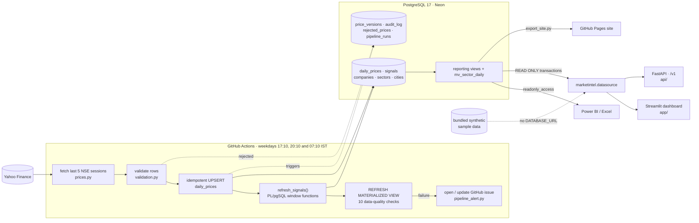
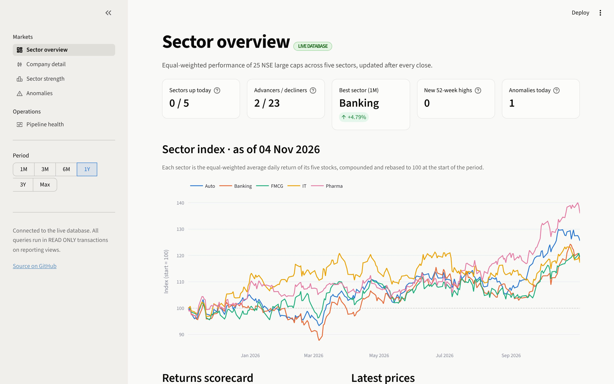
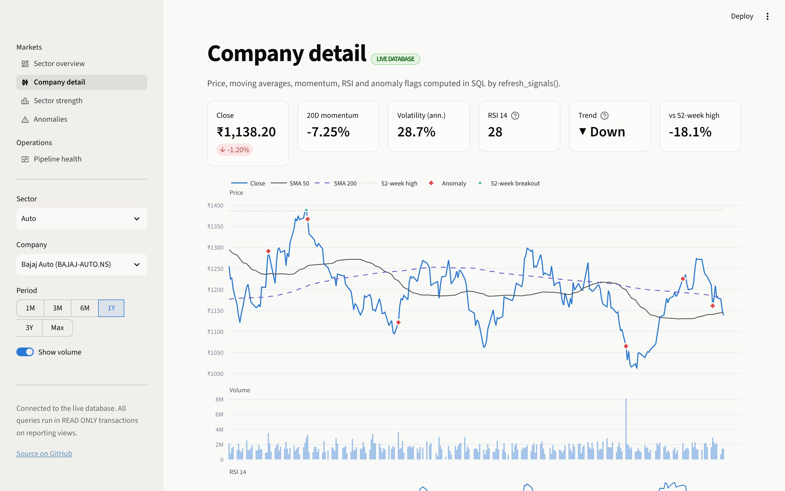
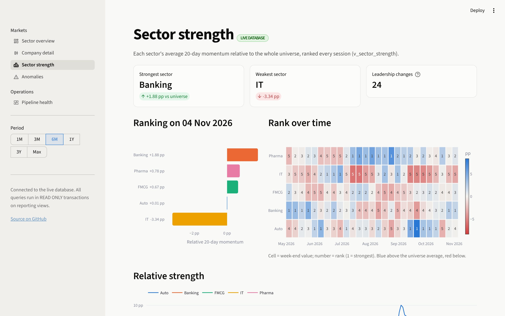
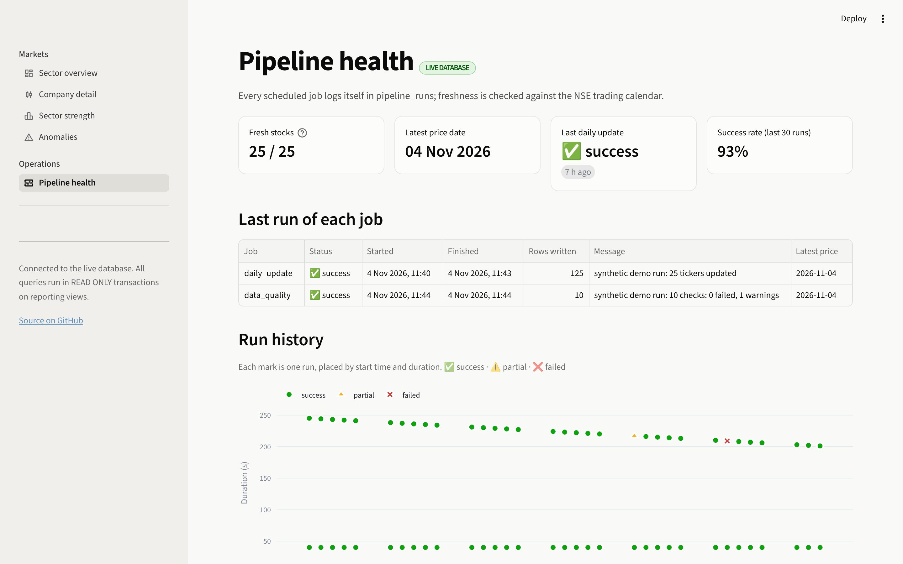
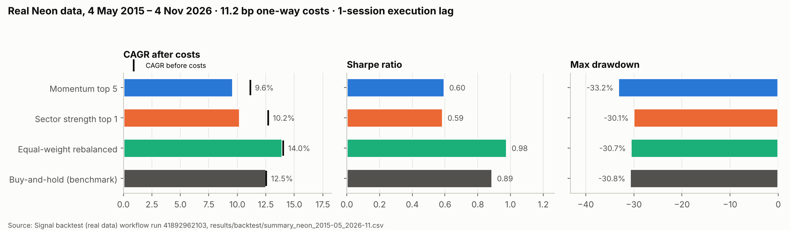
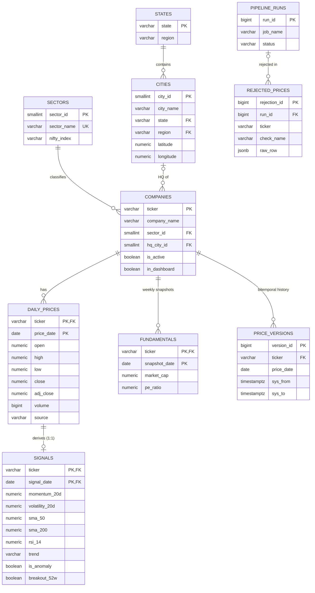

# Sector-Wise Market Intelligence & Signal Dashboard

[](https://github.com/Bhavex/market-intelligence-pg/actions/workflows/tests.yml)
[](https://github.com/Bhavex/market-intelligence-pg/actions/workflows/daily_update.yml)
[](https://github.com/Bhavex/market-intelligence-pg/actions/workflows/site.yml)
[](https://doi.org/10.5281/zenodo.23495953)

A self-updating PostgreSQL warehouse of **25 NSE large caps in 5 sectors**. It has an in-database signal engine, a
Streamlit dashboard, a read-only REST API, an honest backtest and a measured indexing strategy. Built as a DBMS course
project at VIT Vellore.

**Static site: https://bhavex.github.io/market-intelligence-pg/** · **Run everything locally: `docker compose up --build`**

## Highlights

- **Automated pipeline:** loads every weekday after the NSE close, three times a day for resilience. Prices are
  validated before insert, upserted idempotently, and turned into signals by one PL/pgSQL function using window
  functions. A failed run opens a GitHub issue by itself.
- **About 212,500 price rows and as many signal rows** in production for **81 stocks** (the 25 dashboard stocks,
  about 72,700 rows, plus a 56-stock research universe), with history from 2015. See [CLAIMS.md](docs/CLAIMS.md) §2
  for what each row count counts.
- **Schema enforced by the database:** BCNF schema, composite keys, CHECK and FK constraints added without downtime
  (`NOT VALID` → `VALIDATE`), audit triggers, a bitemporal price history, and a least-privilege read-only role.
- **Indexes measured, not assumed:**
  - API pagination takes **0.09 ms** with the primary key, against 27.6 ms without it (about 300×; an earlier run gave
    414×).
  - The sector view takes **0.19 ms** materialized, against 233 ms as a plain view.
  - A view rewrite found by the study cut pipeline-health queries **from 19.2 ms to 0.63 ms**.

  These are medians of 9 runs on a local synthetic database; every individual run is published.

  Details: [PERFORMANCE.md](docs/PERFORMANCE.md).
- **Honest backtest on real Neon data (May 2015 – Nov 2026):** after 11.2 bp NSE costs, momentum returns **9.6%** a
  year and sector rotation **10.2%**, against **12.5%** for equal-weight buy-and-hold (Sharpe 0.60 and 0.59 vs 0.89).
  Neither signal beats the benchmark ([BACKTEST.md](docs/BACKTEST.md)).
- **267 automated tests,** run in CI on every push. Most need no database and no internet; the SQL tests run against
  a throwaway PostgreSQL 17 container.

> **Scope.** End-of-day data, not a real-time feed. Educational analytics, not investment advice.

## Contents
[Architecture](#architecture) · [Dashboard](#dashboard) · [REST API](#rest-api) · [Backtest](#backtest) ·
[Performance](#query-performance) · [Data model](#data-model) · [Stock universe](#stock-universe) · [Setup](#setup) ·
[Docker](#run-it-with-docker) · [Pipeline behaviour](#pipeline-behaviour) · [Data quality](#data-quality) ·
[Signals](#signals) · [Reporting views](#reporting-views-power-bi--excel) · [Testing](#testing) ·
[Repository layout](#repository-layout) · [DBMS concepts](#dbms-concepts-demonstrated) · [Limitations](#known-limitations)

## Architecture



- **Write path (top):** runs only in GitHub Actions with the `DATABASE_URL` secret.
- **Read path (right):** everything reads the reporting views:
  - Power BI and Excel connect through the read-only role;
  - the dashboard and the API share one data-source module that runs queries in `READ ONLY` transactions. Without a
    database it falls back to bundled synthetic data, so both run anywhere.
- **Resilience:** three scheduled runs a day reduce the chance that a delayed schedule or late Yahoo data costs a
  session. The 07:10 IST run is strict and fails if any trading day is missing.

## Dashboard

A five-page Streamlit app (`app/streamlit_app.py`): sector overview, company detail, sector strength, anomalies, and
pipeline health. It has a demo mode, so it runs with no database.

```bash
pip install -r app/requirements.txt && streamlit run app/streamlit_app.py
```

| Sector overview | Company detail |
|---|---|
|  |  |
| **Sector strength** | **Pipeline health** |
|  |  |

*The screenshots show synthetic data served from the Docker stack.* To deploy on Streamlit Community Cloud in a few
clicks, see [docs/DEPLOYMENT.md](docs/DEPLOYMENT.md).

## REST API

A read-only FastAPI service (`api/main.py`), with OpenAPI docs at `/docs`:

| Endpoint | |
|---|---|
| `GET /v1/sectors` · `/v1/sectors/{sector}/companies` | sectors with 1D–YTD returns, companies per sector |
| `GET /v1/companies` · `/v1/companies/{ticker}` | paginated list; one company with its latest quote |
| `GET /v1/companies/{ticker}/prices` · `/signals` | OHLCV and SQL-computed signals with `start`/`end`, `order`, pagination |
| `GET /v1/sectors/strength` | sector ranking for one day or a date range |
| `GET /v1/pipeline/status` | freshness, stale tickers, last run of each job |

```bash
curl "localhost:8000/v1/companies/INFY.NS/prices?start=2026-01-01&order=desc&page_size=50"
```

Every error uses the same envelope (`{"error": {"code", "message", "details"}}`) for 400, 404, 405, 422 and 503.
Tickers, dates and page sizes are validated. Write methods return 405. There are 34 tests, none needing a database.
See [docs/API.md](docs/API.md).

## Backtest

`src/strategy_backtest.py` tests the momentum and sector-strength signals against an equal-weight buy-and-hold of the
same 25 stocks. Signals use data only up to the signal close; trades fill at the next session's close; every rupee
traded pays 11.2 bp. That rules out look-ahead in the *decision timing*. It does not make the data point-in-time: the
price history is today's revised snapshot and the universe is today's members ([CLAIMS.md](docs/CLAIMS.md) §1).

| Real Neon data, 4 May 2015 – 4 Nov 2026, after costs | ₹100 becomes | CAGR | Sharpe | Max drawdown |
|---|---:|---:|---:|---:|
| Momentum top 5 | 282 | 9.6% | 0.60 | −33.2% |
| Sector-strength rotation | 300 | 10.2% | 0.59 | −30.1% |
| Equal-weight, monthly rebalanced | **437** | **14.0%** | **0.98** | −30.7% |
| **Buy-and-hold benchmark** | 379 | 12.5% | 0.89 | −30.8% |



**Neither signal beats the benchmark.** Momentum loses even before costs (11.1% against 12.5% a year). Sector rotation's
0.2 pp gross edge is consumed by trading about 20× its capital a year. Only monthly rebalancing to equal weight beat
buy-and-hold. These figures come from the **Signal backtest (real data)** workflow, which runs on the production Neon
database ([run 41892962103](https://github.com/Bhavex/market-intelligence-pg/actions/runs/41892962103)). Full write-up:
[docs/BACKTEST.md](docs/BACKTEST.md).

## Query performance

`EXPLAIN (ANALYZE, BUFFERS)` on a **local, synthetic** database of 259,600 rows: 100 generated tickers × 2,596
weekdays, sized like the 81-stock production table (212,507 rows). It is not the 25-stock dashboard data, which is
about 72,700 rows. Each index drop runs inside a transaction that is rolled back. Every individual timing is published
in `results/performance/*.json`.

| Query | Indexed | No indexes | Why |
|---|---:|---:|---|
| API prices page, newest first | 0.09 ms | 27.6 ms | backward scan of the `(ticker, price_date)` primary key, stops after 100 rows |
| Latest price per stock (sector overview) | 1.5 ms | > 30 s | `LATERAL … LIMIT 1` is one index probe per stock, or a full scan per row without the index |
| Anomalies, last 180 days | 0.36 ms | 43.8 ms | partial index `WHERE is_anomaly` |
| Sector stats, 1 year | 0.19 ms (materialized) | 233 ms (plain view) | aggregates stored once per load |
| Data freshness | 0.63 ms (old definition: 19.2 ms) | | rewritten from `GROUP BY` to a per-stock `LATERAL` probe after the study |

Method, all ten queries, both scales and what each result means: [docs/PERFORMANCE.md](docs/PERFORMANCE.md).

## Data model



All tables are in BCNF, with one controlled redundancy (`cities.region`, kept consistent by a composite FK to
`states`). Every table and column is described in **[docs/SCHEMA.md](docs/SCHEMA.md)**; the normalisation steps are in
[docs/NORMALISATION.md](docs/NORMALISATION.md), and the latest schema review is in
[docs/MIGRATION_NOTES.md](docs/MIGRATION_NOTES.md).

## Stock universe

5 sectors × 5 large caps, Yahoo symbols with the `.NS` (NSE) suffix (`sql/02_seed.sql`):

| Sector | Tickers |
|---|---|
| **IT** | `TCS.NS` Tata Consultancy Services · `INFY.NS` Infosys · `WIPRO.NS` Wipro · `HCLTECH.NS` HCL Technologies · `TECHM.NS` Tech Mahindra |
| **Banking** | `HDFCBANK.NS` HDFC Bank · `ICICIBANK.NS` ICICI Bank · `SBIN.NS` State Bank of India · `KOTAKBANK.NS` Kotak Mahindra Bank · `AXISBANK.NS` Axis Bank |
| **Auto** | `MARUTI.NS` Maruti Suzuki · `M&M.NS` Mahindra & Mahindra · `BAJAJ-AUTO.NS` Bajaj Auto · `EICHERMOT.NS` Eicher Motors · `HEROMOTOCO.NS` Hero MotoCorp |
| **Pharma** | `SUNPHARMA.NS` Sun Pharma · `DRREDDY.NS` Dr. Reddy's · `CIPLA.NS` Cipla · `DIVISLAB.NS` Divi's Laboratories · `LUPIN.NS` Lupin |
| **FMCG** | `HINDUNILVR.NS` Hindustan Unilever · `ITC.NS` ITC · `NESTLEIND.NS` Nestlé India · `BRITANNIA.NS` Britannia · `DABUR.NS` Dabur India |

`TATAMOTORS.NS` was replaced after the Tata Motors demerger broke the symbol (`replace_company()` procedure).
A separate research universe (NIFTY 50 + 25 small caps, `companies.in_dashboard = FALSE`) is used only by the data-trust
study and never reaches the dashboards.

## Setup

### Prerequisites
- Python 3.12+
- A PostgreSQL 15+ database. A free [Neon](https://neon.tech) project works; production runs on Neon PostgreSQL 17.

### Local
```bash
git clone https://github.com/Bhavex/market-intelligence-pg.git
cd market-intelligence-pg
python3 -m venv .venv && source .venv/bin/activate
pip install -r requirements-dev.txt
cp .env.example .env
```
Put your connection string in `.env` as `DATABASE_URL=…`. `.env` is git-ignored; never commit it.

```bash
python src/setup_db.py
python src/backfill.py --start 2015-01-01
python src/post_load.py
```
`setup_db.py` creates tables, seed data, functions, triggers and views (safe to run again). `backfill.py` loads history
and computes signals. `post_load.py` refreshes the materialized view and runs the data-quality checks.

### Automation (GitHub Actions)
1. **Settings → Secrets and variables → Actions**: add `DATABASE_URL`. It is the only secret; the code never prints it.
2. Run **One-time setup and backfill** from the Actions tab.
3. **Settings → Pages → Source = GitHub Actions** to publish the dashboard.

From then on `daily_update.yml` runs by itself. `tests.yml` runs the test suite on every push and pull request and
never touches the production database.

### Read-only login for Power BI
Create it with SQL (roles made in the Neon console get admin rights):
```sql
CREATE ROLE powerbi_reader WITH LOGIN PASSWORD 'choose-a-long-random-password';
GRANT readonly_access TO powerbi_reader;
```

## Run it with Docker

One command starts everything on your machine with **synthetic** data. No Neon account, no secrets, and nothing leaves
your computer:

```bash
docker compose up --build
```

| Service | What it does | URL |
|---|---|---|
| `db` | PostgreSQL 17 in a named volume (`pgdata`) | `localhost:5432` is not published |
| `init` | runs `scripts/docker_init.py`: applies every `sql/*.sql` file, loads 10 years × 25 tickers of synthetic prices (about 65,000 rows), computes signals with `refresh_signals()`, and creates a read-only login (`dashboard_reader`, member of `readonly_access`); then exits | |
| `dashboard` | Streamlit app, connected as the read-only login (green **LIVE DATABASE** badge) | http://localhost:8501 |
| `api` | FastAPI, same read-only login | http://localhost:8000/docs |

`dashboard` and `api` wait until `init` has completed successfully. Re-running is safe: the loader skips when prices
already exist. `docker compose down -v` deletes the volume and starts from scratch. The passwords in
`docker-compose.yml` are local-only defaults; override them with `POSTGRES_PASSWORD` / `READER_PASSWORD` in your shell
or a `.env` file, and `SAMPLE_YEARS` sets the amount of synthetic history. The image runs as a non-root user.

## Pipeline behaviour

| Rule | How |
|---|---|
| **Re-check window** | every run re-fetches the last **5 NSE trading sessions** (from the trading calendar, not calendar days) and upserts them, so an error *in that window* is replaced by Yahoo's latest value on the next run. Older rows are re-checked by the weekly `revision_scan.py`. Neither path can correct an error Yahoo keeps reporting |
| **No partial bars** | a session counts as final only after **16:30 IST** (15:30 close + 1 h). `guard_final_sessions()` refuses any earlier write made through `upsert_rows()`, the path every loader uses |
| **Write only real changes** | `ON CONFLICT … DO UPDATE … WHERE (old) IS DISTINCT FROM (new)`: unchanged rows are not rewritten, audited or versioned |
| **Approximate rows never overwrite** | if Yahoo's daily series misses a weekday, the day is rebuilt from hourly bars (`source = 'yahoo_hourly'`), **insert-only** |
| **Failures are visible** | each job logs a `pipeline_runs` row (`success` / `partial` / `failed`). The Action goes red if more than half the stocks fail or a data-quality check errors |
| **Provenance** | every value change made through normal DML is versioned in `price_versions` with the `run_id` that caused it |

## Data quality

**Before insert: `src/validation.py`.** Rows that fail a validation rule are logged, stored in `rejected_prices` and
skipped instead of aborting the load. Network or database failures still fail the ticker or the run.

| Check | Action |
|---|---|
| missing open/high/low/close (None/NaN) | reject |
| zero or negative price, negative volume | reject |
| `high < low` | reject |
| duplicate `(ticker, date)` in one fetch | reject the second |
| **isolated spike**: a move beyond ±20% that reverses the next session | reject |
| persistent jump beyond ±20% (not reversed: could be real news) | keep, warn |
| open/close outside the day's range (more than 0.1%) | keep, warn |
| 3+ missing NSE sessions between rows (holiday-aware) | warn |

**After load: `src/post_load.py`.** 10 SQL checks: freshness against the NSE calendar, calendar gaps, impossible prices,
high < low, signal coverage, close outside range, extreme moves, zero volume, and recent validation rejections.
**In the schema:** CHECK constraints, foreign keys and triggers reject the specific impossible values they encode,
such as non-positive prices, `high < low` and RSI outside 0–100. Wrong-but-plausible values are still storable
(see [docs/MIGRATION_NOTES.md](docs/MIGRATION_NOTES.md)).

## Signals

Computed by `refresh_signals()` in `sql/03_signals.sql` from `COALESCE(adj_close, close)`:

| Column | Meaning |
|---|---|
| `return_1d` | daily return (fraction) |
| `momentum_20d`, `momentum_60d` | 20 / 60-session return |
| `volatility_20d` | annualised st. dev. of the last 20 daily returns |
| `sma_50`, `sma_200` | simple moving averages (SMA-200 is NULL until 200 sessions exist) |
| `rsi_14` | 14-session RSI (simple-average version) |
| `volume_zscore_20d` | today's volume against the previous 20 sessions |
| `trend` | `UP` if price > SMA50 > SMA200, `DOWN` if the reverse, else `NEUTRAL` |
| `is_anomaly` | move > 3σ of the previous 20 days, or volume z-score > 3 |
| `high_52w`, `breakout_52w`, `pct_from_52w_high`, `strong_breakout` | 52-week high of the **previous** 252 sessions (today excluded, so a breakout is possible), the breakout flag, distance from the high, and breakout with volume z > 2 |

Details and design notes: [docs/signals.md](docs/signals.md). The SQL engine is compared with an independent pandas
re-implementation, both in the daily workflow (`verify_52w.py`) and in CI (`tests/test_db_integration.py`), and the
formulas are checked against hand-computed examples (`tests/test_signals.py`). Agreement between the two engines
shows they are consistent, not that the definitions are right.

## Reporting views (Power BI / Excel)

Power BI connects through `readonly_access` to **views, not raw tables**:

| View | Use |
|---|---|
| `v_latest_prices_by_sector` | one row per active stock: latest close, day change %, trend, RSI, 52-week distance, rank in sector |
| `v_sector_daily_performance` | per sector per day: equal-weighted return, advancers/decliners, best/worst stock, turnover, sector index = 100 |
| `v_sector_returns_summary` | sector scorecard: 1D / 1W / 1M / 3M / YTD % |
| `v_company_daily` | one wide row per stock per day (price + signals + sector + location) |
| `v_sector_daily` / `mv_sector_daily` | sector averages and breakout counts (materialized copy refreshed after each load) |
| `v_sector_strength`, `v_region_daily`, `v_anomalies` | relative strength ranking, map page, anomaly table |
| `v_pipeline_health`, `v_data_freshness`, `v_rejections_summary` | operations page |

Never `DROP` `v_sector_daily`: its grants and `v_sector_strength` depend on it. Change it with `CREATE OR REPLACE VIEW`
and add columns at the end only.

## Testing

```bash
pip install -r requirements-dev.txt
python -m pytest
```

There are **267 tests**. Without a database, 218 run and 49 database tests skip by design:
- **No database and no internet needed** for most of them. `tests/conftest.py` fakes the psycopg connection and
  `yfinance.Ticker`. The suite covers:
  - validation, signal maths, upsert counting and the session guard;
  - the backfill and daily jobs end to end;
  - every dashboard page, rendered with Streamlit's `AppTest` in demo mode;
  - every API endpoint and error;
  - the backtest's look-ahead, lag and cost rules;
  - the failure-alert script.
- **SQL tests** run when `TEST_DATABASE_URL` points at a **throwaway** database. They cover `refresh_signals()` against
  an independent pandas engine, every constraint and view, the Power BI column contract, and live-mode API calls. They
  run inside rolled-back transactions and never read `DATABASE_URL`.

```bash
TEST_DATABASE_URL=postgresql://localhost/market_test python -m pytest
```

CI (`.github/workflows/tests.yml`) runs the unit tests on Python 3.12 and 3.13. A second job starts a PostgreSQL 17
service container, applies every SQL file twice (to prove they are idempotent), loads synthetic data and runs the full
suite.

## Repository layout

| Path | Contents |
|---|---|
| `sql/01_schema.sql` … `07_trading_calendar.sql` | core tables, seed data, signal engine, views, audit and procedures, materialized view, NSE calendar |
| `sql/08` … `11` | data-trust research layer (bitemporal versions, official reconciliation, trust score, second feed) |
| `sql/12_integrity_and_reporting.sql` | extra constraints and indexes, `states`, `rejected_prices`, Power BI views |
| `src/setup_db.py`, `backfill.py`, `daily_update.py`, `post_load.py` | the pipeline |
| `src/prices.py`, `validation.py`, `db.py` | fetch and upsert, pre-insert validation, connection and run logging |
| `src/verify_52w.py`, `dq_audit.py` | signal verification, DB vs Yahoo audit |
| `src/fundamentals.py`, `benchmark.py`, `export_site.py` | weekly fundamentals, `EXPLAIN ANALYZE` benchmarks, dashboard export |
| `src/revision_scan.py`, `official_prices.py`, `alt_feed.py`, `fragility.py`, `trust_report.py`, `universe.py`, `export_dataset.py` | research study |
| `app/` | Streamlit dashboard (`streamlit_app.py`, `views/`) and its bundled synthetic `sample_data/` |
| `api/` | FastAPI service (`main.py`, `schemas.py`) |
| `marketintel/` | shared read-only data source (`datasource.py`) and synthetic price generator (`sample.py`) |
| `src/strategy_backtest.py`, `src/perf_study.py` | signal backtest; `EXPLAIN ANALYZE` index study |
| `scripts/` | `load_sample_data.py` / `build_demo_data.py` (throwaway databases only), `docker_init.py`, `pipeline_alert.py` |
| `Dockerfile`, `docker-compose.yml` | one-command local stack |
| `tests/` | pytest suite (mocked) and SQL integration tests |
| `demo/viva_queries.sql`, `demo/transactions_demo.sql` | demo queries (joins, CTEs, window functions) and an ACID / isolation demo |
| `docs/` | [API](docs/API.md), [BACKTEST](docs/BACKTEST.md), [PERFORMANCE](docs/PERFORMANCE.md), [DEPLOYMENT](docs/DEPLOYMENT.md), [RESUME](docs/RESUME.md), [SCHEMA](docs/SCHEMA.md), [NORMALISATION](docs/NORMALISATION.md), [MIGRATION_NOTES](docs/MIGRATION_NOTES.md), [BENCHMARKS](docs/BENCHMARKS.md), [TRUST](docs/TRUST.md), [signals](docs/signals.md), [DEMO_DEFENCE](docs/DEMO_DEFENCE.md) |
| `AUDIT.md` | ranked audit of bugs, risks and fixes |
| `site/` | static dashboard (Chart.js + Leaflet) |

## DBMS concepts demonstrated

| Concept | Where |
|---|---|
| ER → relational mapping, functional dependencies, 1NF → BCNF, relational algebra | `docs/NORMALISATION.md`, `docs/MIGRATION_NOTES.md` |
| Primary, composite, foreign and deferrable keys; CHECK / UNIQUE / NOT NULL; `NOT VALID` + `VALIDATE` | `sql/01_schema.sql`, `sql/12_integrity_and_reporting.sql` |
| B-tree, partial and composite indexes; `EXPLAIN ANALYZE` | `sql/01`, `sql/12`, `docs/BENCHMARKS.md` |
| Views, a materialized view with `REFRESH … CONCURRENTLY`, `LATERAL` joins | `sql/04`, `sql/06`, `sql/12` |
| PL/pgSQL function with window functions and UPSERT | `refresh_signals()` |
| Stored procedure with row locking | `replace_company()` |
| Triggers (BEFORE validation, AFTER audit, conditional `WHEN`) | `sql/05`, `sql/08` |
| Roles and least privilege | `readonly_access` |
| Transactions, savepoints, isolation levels | `demo/transactions_demo.sql` |
| Temporal (bitemporal) tables, GiST exclusion constraint, time travel | `sql/08_point_in_time.sql` |

## Known limitations

- **Single free data source.** Yahoo Finance is unofficial. The research layer measures how often it disagrees with
  official NSE/BSE closes ([docs/TRUST.md](docs/TRUST.md)), but the dashboard still relies on it.
- **End of day only**, and today's bar appears only after 16:30 IST.
- **The NSE holiday table currently covers 2026**: add the 2027 list in December, or the strict freshness check will
  fail on the first 2027 holiday.
- **Equal-weighted sector aggregates** (no free-float market caps in the schema).
- **Fundamentals** are weekly snapshots of Yahoo's current values; there is no point-in-time history before the project started.

## Team

- **Database & Pipeline Engineer** (Bhavishya): schema, signal engine, automation, data quality, performance, dashboard site
- **Analytics** (Adya Mohanka): signal validation and analysis
- **Visualisation** (Rhythm Garg): Power BI dashboards and regional map
