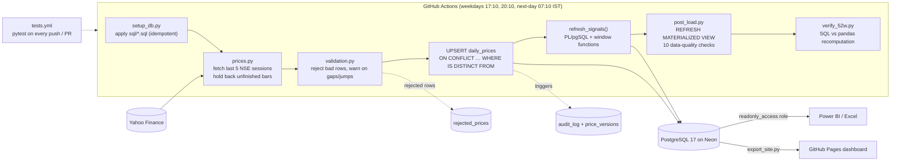
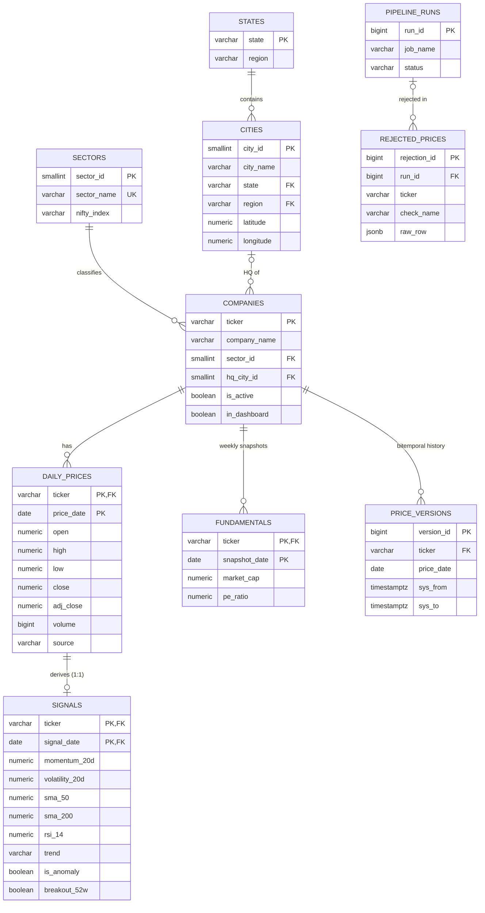

# Sector-Wise Market Intelligence & Signal Dashboard

[](https://github.com/Bhavex/market-intelligence-pg/actions/workflows/tests.yml)
[](https://github.com/Bhavex/market-intelligence-pg/actions/workflows/daily_update.yml)
[](https://github.com/Bhavex/market-intelligence-pg/actions/workflows/site.yml)
[](https://doi.org/10.5281/zenodo.23495953)

**Live dashboard: https://bhavex.github.io/market-intelligence-pg/**

A PostgreSQL database of **25 NSE large-cap stocks in 5 sectors** (IT, Banking, Auto, Pharma, FMCG) that **updates itself
every weekday after the market closes**:

1. prices are fetched from Yahoo Finance (`yfinance`);
2. every row is **validated** before it is stored;
3. the rows are upserted idempotently;
4. trading signals are computed **inside the database** with SQL window functions;
5. data-quality checks run, and the Excel / Power BI reports and the public dashboard read the result.

Built as a DBMS course project at VIT Vellore.

> **Scope.** End-of-day data (history from 2015 plus daily updates), not a real-time feed. Educational analytics, not
> investment advice.

## Contents
[Architecture](#architecture) · [Data model](#data-model) · [Stock universe](#stock-universe) · [Setup](#setup) ·
[Pipeline behaviour](#pipeline-behaviour) · [Data quality](#data-quality) · [Signals](#signals) ·
[Reporting views](#reporting-views-power-bi--excel) · [Testing](#testing) · [Repository layout](#repository-layout) ·
[DBMS concepts](#dbms-concepts-demonstrated) · [Limitations](#known-limitations) · [Team](#team)

## Architecture



Three scheduled runs per trading day, because a delayed GitHub schedule or late Yahoo data must not cost a day. Every
load is an upsert, so running it again is always safe. The 07:10 IST run is *strict*: if a trading day is still
missing, the job fails and GitHub emails the owner.

## Data model



All tables are in BCNF, with one controlled redundancy (`cities.region`, kept consistent by a composite FK to
`states`). Every table and column is described in **[docs/SCHEMA.md](docs/SCHEMA.md)**; the normalisation steps are in
[docs/NORMALISATION.md](docs/NORMALISATION.md), and the latest schema review is in
[docs/MIGRATION_NOTES.md](docs/MIGRATION_NOTES.md).

## Stock universe

5 sectors × 5 large caps, Yahoo symbols with the `.NS` (NSE) suffix (`sql/02_seed.sql`):

| Sector | Tickers |
|---|---|
| **IT** | `TCS.NS` Tata Consultancy Services · `INFY.NS` Infosys · `WIPRO.NS` Wipro · `HCLTECH.NS` HCL Technologies · `TECHM.NS` Tech Mahindra |
| **Banking** | `HDFCBANK.NS` HDFC Bank · `ICICIBANK.NS` ICICI Bank · `SBIN.NS` State Bank of India · `KOTAKBANK.NS` Kotak Mahindra Bank · `AXISBANK.NS` Axis Bank |
| **Auto** | `MARUTI.NS` Maruti Suzuki · `M&M.NS` Mahindra & Mahindra · `BAJAJ-AUTO.NS` Bajaj Auto · `EICHERMOT.NS` Eicher Motors · `HEROMOTOCO.NS` Hero MotoCorp |
| **Pharma** | `SUNPHARMA.NS` Sun Pharma · `DRREDDY.NS` Dr. Reddy's · `CIPLA.NS` Cipla · `DIVISLAB.NS` Divi's Laboratories · `LUPIN.NS` Lupin |
| **FMCG** | `HINDUNILVR.NS` Hindustan Unilever · `ITC.NS` ITC · `NESTLEIND.NS` Nestlé India · `BRITANNIA.NS` Britannia · `DABUR.NS` Dabur India |

`TATAMOTORS.NS` was replaced after the Tata Motors demerger broke the symbol (`replace_company()` procedure).
A separate research universe (NIFTY 50 + 25 small caps, `companies.in_dashboard = FALSE`) is used only by the data-trust
study and never reaches the dashboards.

## Setup

### Prerequisites
- Python 3.12+
- A PostgreSQL 15+ database. A free [Neon](https://neon.tech) project works; production runs on Neon PostgreSQL 17.

### Local
```bash
git clone https://github.com/Bhavex/market-intelligence-pg.git
cd market-intelligence-pg
python3 -m venv .venv && source .venv/bin/activate
pip install -r requirements-dev.txt
cp .env.example .env
```
Put your connection string in `.env` as `DATABASE_URL=…`. `.env` is git-ignored; never commit it.

```bash
python src/setup_db.py
python src/backfill.py --start 2015-01-01
python src/post_load.py
```
`setup_db.py` creates tables, seed data, functions, triggers and views (safe to run again). `backfill.py` loads history
and computes signals. `post_load.py` refreshes the materialized view and runs the data-quality checks.

### Automation (GitHub Actions)
1. **Settings → Secrets and variables → Actions**: add `DATABASE_URL`. It is the only secret; the code never prints it.
2. Run **One-time setup and backfill** from the Actions tab.
3. **Settings → Pages → Source = GitHub Actions** to publish the dashboard.

From then on `daily_update.yml` runs by itself. `tests.yml` runs the test suite on every push and pull request and
never touches the production database.

### Read-only login for Power BI
Create it with SQL (roles made in the Neon console get admin rights):
```sql
CREATE ROLE powerbi_reader WITH LOGIN PASSWORD 'choose-a-long-random-password';
GRANT readonly_access TO powerbi_reader;
```

## Pipeline behaviour

| Rule | How |
|---|---|
| **Self-healing window** | every run re-fetches the last **5 NSE trading sessions** (from the trading calendar, not calendar days) and upserts them, so a wrong row is fixed by the next run. If a stock's data is older, it fetches back to its last stored date |
| **No partial bars** | a session counts as final only after **16:30 IST** (15:30 close + 1 h). `guard_final_sessions()` refuses any earlier write, whatever the code path |
| **Write only real changes** | `ON CONFLICT … DO UPDATE … WHERE (old) IS DISTINCT FROM (new)`: unchanged rows are not rewritten, audited or versioned |
| **Approximate rows never overwrite** | if Yahoo's daily series misses a weekday, the day is rebuilt from hourly bars (`source = 'yahoo_hourly'`), **insert-only** |
| **Failures are visible** | each job logs a `pipeline_runs` row (`success` / `partial` / `failed`). The Action goes red if more than half the stocks fail or a data-quality check errors |
| **Provenance** | every value change is versioned in `price_versions` with the `run_id` that caused it |

## Data quality

**Before insert: `src/validation.py`.** Bad rows are logged, stored in `rejected_prices` and skipped. They never
crash the run.

| Check | Action |
|---|---|
| missing open/high/low/close (None/NaN) | reject |
| zero or negative price, negative volume | reject |
| `high < low` | reject |
| duplicate `(ticker, date)` in one fetch | reject the second |
| **isolated spike**: a move beyond ±20% that reverses the next session | reject |
| persistent jump beyond ±20% (not reversed: could be real news) | keep, warn |
| open/close outside the day's range (more than 0.1%) | keep, warn |
| 3+ missing NSE sessions between rows (holiday-aware) | warn |

**After load: `src/post_load.py`.** 10 SQL checks: freshness against the NSE calendar, calendar gaps, impossible prices,
high < low, signal coverage, close outside range, extreme moves, zero volume, and recent validation rejections.
**In the schema:** CHECK constraints, foreign keys and triggers make impossible values unstorable
(see [docs/MIGRATION_NOTES.md](docs/MIGRATION_NOTES.md)).

## Signals

Computed by `refresh_signals()` in `sql/03_signals.sql` from `COALESCE(adj_close, close)`:

| Column | Meaning |
|---|---|
| `return_1d` | daily return (fraction) |
| `momentum_20d`, `momentum_60d` | 20 / 60-session return |
| `volatility_20d` | annualised st. dev. of the last 20 daily returns |
| `sma_50`, `sma_200` | simple moving averages (SMA-200 is NULL until 200 sessions exist) |
| `rsi_14` | 14-session RSI (simple-average version) |
| `volume_zscore_20d` | today's volume against the previous 20 sessions |
| `trend` | `UP` if price > SMA50 > SMA200, `DOWN` if the reverse, else `NEUTRAL` |
| `is_anomaly` | move > 3σ of the previous 20 days, or volume z-score > 3 |
| `high_52w`, `breakout_52w`, `pct_from_52w_high`, `strong_breakout` | 52-week high of the **previous** 252 sessions (today excluded, so a breakout is possible), the breakout flag, distance from the high, and breakout with volume z > 2 |

Details and design notes: [docs/signals.md](docs/signals.md). The SQL engine is checked against an independent pandas
implementation, both in the daily workflow (`verify_52w.py`) and in CI (`tests/test_db_integration.py`).

## Reporting views (Power BI / Excel)

Power BI connects through `readonly_access` to **views, not raw tables**:

| View | Use |
|---|---|
| `v_latest_prices_by_sector` | one row per active stock: latest close, day change %, trend, RSI, 52-week distance, rank in sector |
| `v_sector_daily_performance` | per sector per day: equal-weighted return, advancers/decliners, best/worst stock, turnover, sector index = 100 |
| `v_sector_returns_summary` | sector scorecard: 1D / 1W / 1M / 3M / YTD % |
| `v_company_daily` | one wide row per stock per day (price + signals + sector + location) |
| `v_sector_daily` / `mv_sector_daily` | sector averages and breakout counts (materialized copy refreshed after each load) |
| `v_sector_strength`, `v_region_daily`, `v_anomalies` | relative strength ranking, map page, anomaly table |
| `v_pipeline_health`, `v_data_freshness`, `v_rejections_summary` | operations page |

Never `DROP` `v_sector_daily`: its grants and `v_sector_strength` depend on it. Change it with `CREATE OR REPLACE VIEW`
and add columns at the end only.

## Testing

```bash
pip install -r requirements-dev.txt
python -m pytest
```
- **No database and no internet needed.** `tests/conftest.py` provides a fake psycopg connection and a fake
  `yfinance.Ticker`. The suite covers validation, signal maths, upsert counting, fallback handling, the session guard,
  and the backfill and daily jobs end to end.
- **SQL tests** (`tests/test_db_integration.py` and the DB classes in the older unittest files) run when
  `TEST_DATABASE_URL` points at a **throwaway** database with the schema applied. They run inside rolled-back
  transactions and never read `DATABASE_URL`.

```bash
TEST_DATABASE_URL=postgresql://localhost/market_test python -m pytest
```
- CI (`.github/workflows/tests.yml`) runs the unit tests on Python 3.12 and 3.13. It also starts a PostgreSQL 17 service
  container, applies every SQL file twice (proving idempotency) and runs the SQL tests.

## Repository layout

| Path | Contents |
|---|---|
| `sql/01_schema.sql` … `07_trading_calendar.sql` | core tables, seed data, signal engine, views, audit and procedures, materialized view, NSE calendar |
| `sql/08` … `11` | data-trust research layer (bitemporal versions, official reconciliation, trust score, second feed) |
| `sql/12_integrity_and_reporting.sql` | extra constraints and indexes, `states`, `rejected_prices`, Power BI views |
| `src/setup_db.py`, `backfill.py`, `daily_update.py`, `post_load.py` | the pipeline |
| `src/prices.py`, `validation.py`, `db.py` | fetch and upsert, pre-insert validation, connection and run logging |
| `src/verify_52w.py`, `dq_audit.py` | signal verification, DB vs Yahoo audit |
| `src/fundamentals.py`, `benchmark.py`, `export_site.py` | weekly fundamentals, `EXPLAIN ANALYZE` benchmarks, dashboard export |
| `src/revision_scan.py`, `official_prices.py`, `alt_feed.py`, `fragility.py`, `trust_report.py`, `universe.py`, `export_dataset.py` | research study |
| `tests/` | pytest suite (mocked) and SQL integration tests |
| `demo/viva_queries.sql`, `demo/transactions_demo.sql` | demo queries (joins, CTEs, window functions) and an ACID / isolation demo |
| `docs/` | [SCHEMA](docs/SCHEMA.md), [NORMALISATION](docs/NORMALISATION.md), [MIGRATION_NOTES](docs/MIGRATION_NOTES.md), [BENCHMARKS](docs/BENCHMARKS.md), [TRUST](docs/TRUST.md), [signals](docs/signals.md), [DEMO_DEFENCE](docs/DEMO_DEFENCE.md) |
| `AUDIT.md` | ranked audit of bugs, risks and fixes |
| `site/` | static dashboard (Chart.js + Leaflet) |

## DBMS concepts demonstrated

| Concept | Where |
|---|---|
| ER → relational mapping, functional dependencies, 1NF → BCNF, relational algebra | `docs/NORMALISATION.md`, `docs/MIGRATION_NOTES.md` |
| Primary, composite, foreign and deferrable keys; CHECK / UNIQUE / NOT NULL; `NOT VALID` + `VALIDATE` | `sql/01_schema.sql`, `sql/12_integrity_and_reporting.sql` |
| B-tree, partial and composite indexes; `EXPLAIN ANALYZE` | `sql/01`, `sql/12`, `docs/BENCHMARKS.md` |
| Views, a materialized view with `REFRESH … CONCURRENTLY`, `LATERAL` joins | `sql/04`, `sql/06`, `sql/12` |
| PL/pgSQL function with window functions and UPSERT | `refresh_signals()` |
| Stored procedure with row locking | `replace_company()` |
| Triggers (BEFORE validation, AFTER audit, conditional `WHEN`) | `sql/05`, `sql/08` |
| Roles and least privilege | `readonly_access` |
| Transactions, savepoints, isolation levels | `demo/transactions_demo.sql` |
| Temporal (bitemporal) tables, GiST exclusion constraint, time travel | `sql/08_point_in_time.sql` |

## Known limitations

- **Single free data source.** Yahoo Finance is unofficial. The research layer measures how often it disagrees with
  official NSE/BSE closes ([docs/TRUST.md](docs/TRUST.md)), but the dashboard still relies on it.
- **End of day only**, and today's bar appears only after 16:30 IST.
- **The NSE holiday table currently covers 2026**: add the 2027 list in December, or the strict freshness check will
  fail on the first 2027 holiday.
- **Equal-weighted sector aggregates** (no free-float market caps in the schema).
- **Fundamentals** are weekly snapshots of Yahoo's current values; there is no point-in-time history before the project started.

## Team

- **Database & Pipeline Engineer** (Bhavishya): schema, signal engine, automation, data quality, performance, dashboard site
- **Analytics** (Adya Mohanka): signal validation and analysis
- **Visualisation** (Rhythm Garg): Power BI dashboards and regional map
