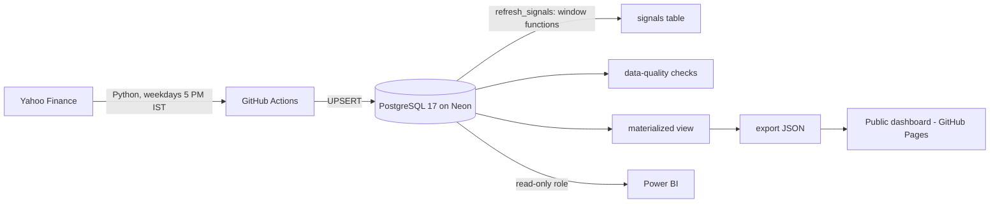

# NSE Sector Intelligence: a self-updating market database

[](https://doi.org/10.5281/zenodo.23495953)
[](https://github.com/Bhavex/market-intelligence-pg/actions/workflows/daily_update.yml)
[](https://github.com/Bhavex/market-intelligence-pg/actions/workflows/site.yml)

**Live dashboard → https://bhavex.github.io/market-intelligence-pg/**

A PostgreSQL database of 25 NSE large-cap stocks across 5 sectors (IT, Banking, Auto, Pharma, FMCG) that **updates itself every weekday after market close**: prices are loaded from Yahoo Finance, trading signals are computed *inside the database* with SQL window functions, data-quality checks run automatically, and a public dashboard is rebuilt — with zero manual work.

Built as a DBMS course project at VIT Vellore.

> **Scope:** end-of-day data (history from 2015 + daily updates), not a real-time feed. Educational analytics, not investment advice.

## Architecture



## Highlights

- **~73,000 price rows + ~73,000 signal rows**, loaded by an idempotent backfill and kept current by a scheduled pipeline
- **Signal engine in SQL:** momentum, volatility, 50/200-day moving averages, RSI, volume z-score, 52-week high breakouts, trend and anomaly flags, all in one PL/pgSQL function using window functions and `INSERT … ON CONFLICT`
- **Measured performance:** indexes, a partial index, a materialized view and year partitioning are benchmarked with `EXPLAIN ANALYZE` every week → [docs/BENCHMARKS.md](docs/BENCHMARKS.md)
- **Data-quality gate:** 9 automated checks (freshness, impossible prices, missing trading days, signal coverage…) fail the pipeline if data is bad
- **Auditability:** triggers write every change to an `audit_log` (JSONB before/after), and every job logs itself in `pipeline_runs`
- **Security:** least-privilege read-only role for analysts and Power BI; secrets only in GitHub Actions
- **Sector-rotation backtest** (2015 to today) on the live dashboard
- **Research layer: how much can you trust free market data?** A bitemporal `price_versions` table keeps every version of every price (temporal exclusion constraint, run-level provenance, `prices_as_of()` time travel), every revision is classified, Yahoo is reconciled against NSE/BSE official files, each price gets a trust score, and a validated simulation measures how often data errors flip each signal. Run on 75 stocks (NIFTY 50 + 25 small caps) and two Yahoo listings (NSE and BSE), with results by company size and an open, citable dataset → [docs/TRUST.md](docs/TRUST.md)

## DBMS concepts used

| Concept | Where |
|---|---|
| ER model → relational mapping, FDs, 1NF → BCNF, relational algebra | [docs/NORMALISATION.md](docs/NORMALISATION.md), [docs/ER_DIAGRAM.md](docs/ER_DIAGRAM.md) |
| PK / FK / composite keys, CHECK / UNIQUE / NOT NULL | `sql/01_schema.sql` |
| B-tree and partial indexes | `sql/01_schema.sql` |
| Views and a materialized view | `sql/04_views.sql`, `sql/06_performance.sql` |
| Stored function (PL/pgSQL, window functions, UPSERT) | `refresh_signals()` in `sql/03_signals.sql` |
| Stored procedure (atomic multi-step change, row locking) | `replace_company()` in `sql/05_audit_and_procedures.sql` |
| Triggers (AFTER audit, BEFORE validation, conditional `WHEN`) | `sql/05_audit_and_procedures.sql` |
| Roles & privileges | `readonly_access` role in `sql/05_audit_and_procedures.sql` |
| Transactions, savepoints, isolation levels | `demo/transactions_demo.sql` |
| Query optimisation (`EXPLAIN ANALYZE`), partitioning | `src/benchmark.py` → [docs/BENCHMARKS.md](docs/BENCHMARKS.md) |
| Temporal (bitemporal / system-versioned) tables, exclusion constraint with GiST, time-travel queries | `sql/08_point_in_time.sql` → [docs/TRUST.md](docs/TRUST.md) |
| Data provenance & lineage (run-level), data fusion across sources | `sql/08_point_in_time.sql`, `sql/09_reconciliation.sql` |
| Derived quality metadata (per-row trust score) | `sql/10_trust.sql` |

## Repository layout

| Path | What it is |
|---|---|
| `sql/01_schema.sql` | Tables, keys, constraints, indexes |
| `sql/02_seed.sql` | Sectors, HQ cities (with lat/long), 25 companies |
| `sql/03_signals.sql` | `refresh_signals(from_date)`: the signal engine |
| `sql/04_views.sql` | Reporting views (`v_company_daily`, `v_latest_snapshot`, `v_sector_daily`, `v_sector_strength`, `v_region_daily`, `v_anomalies`, `v_pipeline_health`) |
| `sql/05_audit_and_procedures.sql` | Audit log + triggers, validation trigger, `replace_company()` procedure, read-only role |
| `sql/06_performance.sql` | Materialized view `mv_sector_daily` |
| `src/setup_db.py` | Applies all SQL files (idempotent, runs before every load) |
| `src/backfill.py` | One-time history load from 2015 |
| `src/daily_update.py` | Incremental daily load (re-upserts the last 5 sessions) + signal refresh |
| `src/post_load.py` | Refreshes the materialized view, runs data-quality checks |
| `src/fundamentals.py` | Weekly fundamentals snapshot |
| `src/verify_52w.py`, `sql/validation/52w_checks.sql` | Validation of the 52-week signals |
| `src/dq_audit.py` | Data-quality audit: stored prices vs Yahoo |
| `src/adya_snapshot.py`, `sql/analytics/` | Analytics report queries and a before/after comparison tool |
| `tests/` | Unit tests for the price pipeline |
| `src/benchmark.py` | `EXPLAIN ANALYZE` benchmarks → `docs/BENCHMARKS.md` |
| `sql/08`–`sql/11`, `src/revision_scan.py`, `src/official_prices.py`, `src/fragility.py`, `src/trust_report.py` | Data-trust research layer (versions, official reconciliation, trust score, fragility) |
| `src/universe.py`, `src/alt_feed.py`, `sql/11_research.sql` | Research universe (NIFTY 50 + 25 small caps), Yahoo BSE feed, results by group |
| `src/export_dataset.py`, `CITATION.cff` | Open research dataset (derived data only) and citation |
| `src/export_site.py` | Exports dashboard JSON + computes the backtest |
| `site/` | Static dashboard (Chart.js + Leaflet), deployed to GitHub Pages |
| `demo/viva_queries.sql` | 14 demo queries: joins, GROUP BY/HAVING, subqueries, window functions, CTEs |
| `demo/transactions_demo.sql` | ACID demo: atomicity, constraints, savepoints, procedures, isolation |
| `.github/workflows/` | Daily load, site publish, weekly benchmark, weekly fundamentals, weekly data trust study, dataset release, one-time backfill |

## Signals

| Column | Meaning |
|---|---|
| `return_1d` | Daily return (fraction) |
| `momentum_20d`, `momentum_60d` | 20 / 60 trading-day return |
| `volatility_20d` | Annualised stdev of daily returns (20-day) |
| `sma_50`, `sma_200` | Simple moving averages (SMA-200 is NULL until 200 days exist) |
| `rsi_14` | 14-day RSI (simple-average version) |
| `volume_zscore_20d` | Today's volume vs. the previous 20 days |
| `trend` | `UP` if price > SMA50 > SMA200, `DOWN` if reverse, else `NEUTRAL` |
| `is_anomaly` | Move > 3σ of the prior 20 days, or volume z-score > 3 |
| `high_52w` | Highest `adj_close` of the **previous 252 trading days, today excluded** |
| `breakout_52w` | `adj_close > high_52w` (a new 52-week high) |
| `pct_from_52w_high` | `ROUND((adj_close / high_52w - 1) * 100, 2)` — **negative below the high, positive on a breakout day** (e.g. `-3.20` = 3.2% under the high, `+1.14` = 1.14% above it) |
| `strong_breakout` | `breakout_52w` AND `volume_zscore_20d > 2` (a NULL z-score counts as FALSE) |

Prices use `adj_close` (split/dividend-adjusted) when available.

### 52-week signals: definitions and rules

- **Why the high excludes today:** the window is `ROWS BETWEEN 252 PRECEDING AND 1 PRECEDING`. If today were
  inside the window, today's close could never exceed its own maximum, so `breakout_52w` would be
  impossible and `pct_from_52w_high` could never be positive. Comparing today with the *previous* 252 sessions
  is what makes "new 52-week high" mean something. 252 trading days ≈ one year.
- **NULL until there is enough history:** a row gets a value only if it has exactly 252 prior non-null
  `adj_close` rows (`COUNT(adj_close) = 252` over the same window). Otherwise all four columns are NULL, so every
  stock has 252 leading NULL rows (fewer or more only if `adj_close` itself has gaps: a missing `adj_close`
  also blanks the next 252 rows). A row whose own `adj_close` is NULL is NULL too.
- **Full history on every run:** Yahoo restates old `adj_close` after dividends, so the four columns are
  recomputed over the *entire* `daily_prices` history of every ticker each time `refresh_signals()` runs
  (about 70k rows, a few seconds), never only for new dates. Only rows whose values changed are written.
  `strong_breakout` is computed after `volume_zscore_20d` in the same call.
- **Rounding:** `breakout_52w` compares the unrounded values; `high_52w` and `pct_from_52w_high` are
  rounded for display (2 decimals), so in a rare tie `adj_close > high_52w` on the rounded numbers can differ from the flag.
- The columns are added by an idempotent `ALTER TABLE ... ADD COLUMN IF NOT EXISTS` in `sql/01_schema.sql`.
  `powerbi_reader` keeps `SELECT` on `signals` (the table-level grant to `readonly_access` covers new columns).

## Run it yourself

```bash
git clone https://github.com/Bhavex/market-intelligence-pg.git
cd market-intelligence-pg
python3 -m venv .venv && source .venv/bin/activate
pip install -r requirements.txt
cp .env.example .env          # paste a PostgreSQL connection string (e.g. a free Neon database)
python src/setup_db.py        # tables, seed data, functions, triggers, views
python src/backfill.py        # load history from 2015
python src/post_load.py       # materialized view + data-quality checks
```

For automation, add the connection string as the GitHub Actions secret `DATABASE_URL`, then run **One-time setup and backfill** from the Actions tab. To publish the dashboard, set **Settings → Pages → Source** to **GitHub Actions**.

## Daily update behaviour

`src/daily_update.py` runs after the close and is built so that a wrong row corrects itself:

- **Re-upserts the last 5 NSE trading sessions for every ticker on every run**
  (`ON CONFLICT (ticker, price_date) DO UPDATE`; the 5 sessions come from the trading calendar in
  `sql/07_trading_calendar.sql`, not 5 calendar days). If a ticker's stored data is older than that window it
  fetches back to its last stored date. Only rows whose values changed are rewritten (and audited).
- **Never stores a partial same-day bar:** today's bar is held back until **16:30 IST** (15:30 close + 1 hour buffer;
  the same cut-off as `expected_latest_trading_day()`). A run at 09:40 stores nothing for today.
- **Logs what it did:** per ticker and in total — rows *inserted*, *updated* (value changed, with the dates),
  *unchanged* and *held back* (session not final). `pipeline_runs.rows_upserted` counts rows actually written and
  `pipeline_runs.message` carries the breakdown.
- **Hourly fallback is insert-only:** when Yahoo's daily series lacks a weekday, a row is rebuilt from hourly bars. Those
  rows are approximate (close is right, but open/high/low can be slightly off and the summed volume can be 20–50% low)
  so they only fill a gap and can never overwrite a stored row; Yahoo's daily bar replaces them if it appears later.

Tools (all read-only except the tests' rolled-back transactions):

| Command | Purpose |
|---|---|
| `python src/verify_52w.py` | Checks the 52-week signals (SQL checks in `sql/validation/52w_checks.sql` + an independent pandas recomputation); runs in the daily workflow |
| `python src/dq_audit.py` | Stored prices vs Yahoo for the last 10 sessions, all tickers: >0.5% differences, rows on weekends/holidays, missing trading days, identical consecutive closes, rows written before the close |
| `python src/adya_snapshot.py --tag before` / `--compare before after` | Saves/compares the results of the analytics report's queries 3a, 3b, 3c, 5 (`sql/analytics/person_b_queries.sql`) |
| `TEST_DATABASE_URL=... python -m unittest discover -s tests -v` | Unit tests; DB tests need a throwaway database and never read `DATABASE_URL` |

## Reporting views

| View | Notes |
|---|---|
| `v_company_daily` | One row per company per day: price + signals + sector + location |
| `v_sector_daily` | Equal-weighted sector stats per day. Columns, in order: `price_date, sector_name, n_stocks, avg_return_1d, avg_momentum_20d, avg_volatility_20d, avg_rsi_14, n_uptrend, n_downtrend, n_anomalies`, then the new **`breakout_count`** (stocks with `breakout_52w` TRUE that day in the sector) and **`strong_breakout_count`** (those with `strong_breakout`), both `bigint`. |
| `v_sector_strength` | Sector 20-day momentum vs the universe, ranked per day (unchanged) |

`v_sector_daily` is changed with `CREATE OR REPLACE VIEW` and the new columns are appended at the end, so existing
column names, order and types — and the `powerbi_reader` grants — are untouched. **Never `DROP` this view**: dropping it
removes the grants and breaks `v_sector_strength`. The materialized copy `mv_sector_daily` keeps its original 10
columns (a materialized view cannot be altered in place); read the new counts from `v_sector_daily`, or drop and recreate
`mv_sector_daily` (and re-grant `SELECT` to `readonly_access`) if the site/Power BI should read them from the materialized copy.

## Read-only access for teammates / Power BI

Create the login **with SQL** (roles made in the Neon Console UI get admin rights):

```sql
CREATE ROLE powerbi_reader WITH LOGIN PASSWORD 'choose-a-long-random-password-here';
GRANT readonly_access TO powerbi_reader;
```

## Team

- **Database & Pipeline Engineer** (Bhavishya): schema, signal engine, automation, data quality, performance, dashboard site
- **Analytics**: signal validation and analysis
- **Visualisation**: Power BI dashboards and regional map
