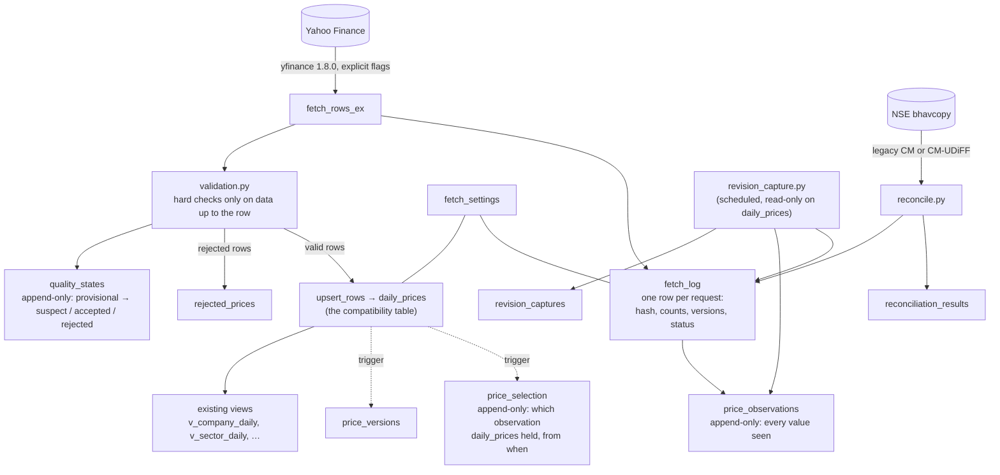

# Data lineage and point-in-time design

This branch rebuilds the foundations so the database can answer three questions it could not answer before:
- **What exactly did we fetch, when, with which settings?**
- **What did we believe about a price at any past moment, and why?**
- **Which stocks were in the universe on a given day?**

Everything here was built and tested against a local PostgreSQL with synthetic and fixture data. None of it changes
the existing tables' columns, the Power BI views, the daily workflow schedule or how secrets are used.

## The flow of one price

`daily_prices` keeps its role and its columns, so every existing view, the dashboard, the API and Power BI read it
exactly as before. The new append-only tables around it hold the history and the evidence.

## The new tables (migrations 13–22)

| Migration | Object | Purpose |
|---|---|---|
| `13_price_semantics.sql` | `fetch_settings`, `daily_prices.settings_id`, `pipeline_runs.settings_id`, `v_price_semantics` | Each distinct set of fetch settings is stored once: library, installed version, `auto_adjust`, `repair`, `actions` and every other flag, interval, and the **price basis** (`close` = `split_adjusted`, `adj_close` = `split_and_dividend_adjusted`). Every price row written records the settings it was written with. |
| `14_quality_states.sql` | `quality_states`, `v_quality_current`, `quality_as_of(ts)`, `forbid_mutation()` | Timestamped quality states per stock-day. Append-only. |
| `15_fetch_ledger.sql` | `fetch_log`, `v_fetch_summary` | One row per request: source, endpoint, symbol, full request, retrieval time, response hash and its basis, rows returned / parsed / valid / rejected / suspect / held back, library version, settings, parser version, validation and quality rule versions, status, error. Append-only. |
| `16_price_observations.sql` | `price_observations`, `price_selection`, `observations_as_of(ts)`, `selected_prices_as_of(ts)`, `v_observation_revisions`, `v_selection_provenance` | Append-only observations plus the history of which observation is selected. |
| `17_revision_capture.sql` | `revision_captures`, `revision_capture_coverage`, `v_revision_capture_summary`, `v_revision_capture_rate` | Prospective revision measurement. |
| `18_instruments.sql` | `instruments`, `instrument_symbols`, `universe_membership`, `universe_members(u, d)`, `v_universe_membership`, `v_tata_hero_switch` | Stable identity and dated membership. |
| `19_bhavcopy_reconciliation.sql` | `reconciliation_results`, `v_reconciliation_latest`, `v_reconciliation_summary` | Official-file reconciliation. |
| `20_run_leases.sql` | `run_leases`, `run_lease_log`, `pipeline_runs.heartbeat_at`, `acquire_run_lease()`, `renew_run_lease()`, `release_run_lease()`, `reap_stale_runs()`, `v_run_leases`, `v_stale_runs`, `v_lease_holdings`, `v_lease_overlaps` | One writer at a time, and dead runs closed. The lease log is append-only. |
| `21_session_coverage.sql` | `calendar_coverage`, `trading_suspensions`, `expected_sessions()`, `session_coverage()`, `v_expected_sessions`, `v_session_coverage`, `v_session_coverage_summary`, `v_session_coverage_by_ticker` | Every expected ticker-session pair, classified. |
| `22_backtest_trials.sql` | `backtest_trials`, `v_backtest_trial_counts`, `v_backtest_holdout_looks` | Every backtest evaluation ever run. Append-only. |

"Append-only" is enforced by the database, not by convention: a `BEFORE UPDATE OR DELETE` trigger raises
`restrict_violation`. Tests show that `UPDATE` and `DELETE` fail on every one of these tables. (`TRUNCATE` bypasses row
triggers; only the synthetic-data loader uses it, and only on throwaway databases.)

## 1. Price semantics

yfinance is pinned (`requirements.txt`, `src/fetch_config.py`). Every fetch passes `auto_adjust=False`,
`back_adjust=False`, `repair=False`, `actions=False`, `prepost=False`, `keepna=False`, `rounding=False`,
`raise_errors=False` and a timeout explicitly. Library defaults are never relied on, because they change between
releases (`auto_adjust` defaulted to `False`, then `True`). With these settings Yahoo's `Close` is split-adjusted but
not dividend-adjusted, and `Adj Close` is split- and dividend-adjusted. Those are the bases stored, and they are what
`reconcile.py` checks against NSE's unadjusted close.

## 2. Quality states: no future-dependent cleaning

The old rule rejected a jump when **the next session** reversed it. A decision about day *t* therefore depended on day
*t+1*, so the cleaned history embedded the future. That is a look-ahead bias in the data itself.

Now:
- **At ingest** a row is judged only on data up to itself (`validation.py`, rule version `validation-v3`):
  - hard failures (missing OHLC, non-positive prices, `high < low`, negative volume, duplicates) → `rejected`, not
    stored;
  - a move beyond ±20% against the last *unflagged* session → `suspect`, stored;
  - otherwise → `provisional`.
- **Later runs** append transitions using the evidence available then (`quality.py`, rule version `quality-v2`):

| From | Evidence (available at the later run) | To | `reason` |
|---|---|---|---|
| suspect | the next session moved back by more than ±20% to within 20% of the pre-jump price | **rejected** | `reversed_next_session` |
| suspect | the next session did not reverse | **accepted** | `jump_persisted` |
| suspect | an earlier jump was accepted, so this row is now within 20% of its reference | provisional | `reference_confirmed` |
| provisional | re-fetched unchanged at least a day after the session closed | **accepted** | `reconfirmed_by_later_fetch` |
| any | a re-fetch returned a different value | provisional / suspect | `revised_value` |

The earlier state is never overwritten. `quality_as_of('2026-10-14 18:00+05:30')` returns what the database believed
then, and `v_quality_current` what it believes now. A re-fetch of an unchanged value never resets a state, and a
malformed re-fetch never rejects a good stored row.

**Backtest.** At each decision, `QualityTimeline` masks every row whose state *known at the decision time* (23:59 IST
on the signal day) was `suspect` or `rejected`. A rejection decided later cannot leak back
(`tests/test_quality.py::TestPointInTimeBacktest`).

## 3. Fetch ledger

Every Yahoo request (daily and the hourly fallback), every revision-capture request and every bhavcopy download gets
a `fetch_log` row, including failures and empty responses. There is one honest limitation: **yfinance returns a parsed
DataFrame, not the HTTP body**. So for Yahoo the hash is SHA-256 of a canonical CSV of that frame
(`hash_basis = 'canonical_frame_csv'`). It proves whether two responses parsed to the same data, not that the bytes
were identical. Bhavcopy downloads hash the raw bytes (`hash_basis = 'raw_bytes'`).

## 4. Observations and selection

- `price_observations` holds every value the feed returned, with the `fetch_id`, source, basis and observation time.
  A re-fetch that returns the same values appends nothing; the ledger row still proves the fetch happened. A changed
  value appends a new row, and a revision back to an earlier value appends again.
- `price_selection` is written **by a trigger** on `daily_prices`. Every insert, update and delete records which
  observation (matched on key, source and a value hash) the row now holds. A write that matches no observation
  (manual SQL, the synthetic loader) is recorded with `observation_id NULL`, and `post_load.py` warns about such
  writes in the last 7 days.
- **As-of queries:**
  - `observations_as_of(ts)`: the latest value *seen* for each stock-day by time `ts`;
  - `selected_prices_as_of(ts)`: what `daily_prices` *held* at `ts`, linked to its observation and fetch.
  - The older `prices_as_of(ts)` (`sql/08`) still works on `price_versions`.

These records begin when this branch is deployed. History loaded earlier has no observations, and its selection
starts at deployment. The as-of functions are exact from then on, not before.

## 5. Prospective revision capture

`revision_capture.yml` runs on weekdays at 22:53 IST, after the daily runs and in the same concurrency group. For every
active stock it re-fetches:
- the **last 10 trading sessions**;
- **one rotating older calendar month**. The month is chosen deterministically from the run date, so the job visits
  every month of history once per cycle.

Each run logs its fetches, appends changed values as observations, and records every field that differs from
`daily_prices`, plus rows missing in or new to the feed, in `revision_captures`. Coverage (rows compared per window) is
kept in `revision_capture_coverage`, so rates have a denominator (`v_revision_capture_rate`). It **never writes
`daily_prices`**: it measures, it does not correct.

## 6. Instrument identity and dated membership

- `instruments` gives every company a stable `instrument_id` (and ISIN when known). `companies.instrument_id` links
  the two.
- `instrument_symbols` holds vendor symbols with `valid_from` / `valid_to`.
- `universe_membership` holds universe membership with dates, a reason and the evidence for the dates. GiST exclusion
  constraints forbid overlapping intervals.
- **Tata Motors and Hero MotoCorp.** In `dashboard_25`, Tata Motors (`TATAMOTORS.NS`) is a member from 2015 until the
  switch date, and Hero MotoCorp from the switch date on. Neither replaces the other in history. The switch date is
  taken from the database's own evidence, recorded in `v_tata_hero_switch.evidence`:
  1. the `audit_log` entry that deactivated Tata Motors;
  2. otherwise, the day after its last stored price;
  3. otherwise, a labelled fallback estimate (**14 Oct 2025, the demerger record date; verify it**).

  **Check that view on production before relying on the date.**
- `replace_company()` now ends the old membership and symbol and starts the new ones.
- **Backtest.** Each decision sees only the members on its decision date, and the buy-and-hold benchmark hands a
  leaver's weight to the joiner. A test shows that without this, a future member leaks into earlier decisions.

## 7. NSE bhavcopy reconciliation

`src/bhavcopy.py` parses both NSE formats into one shape, plain or zipped:
- the **legacy CM bhavcopy** (`cmDDMONYYYYbhav.csv`, up to July 2024);
- **CM-UDiFF** (`BhavCopy_NSE_CM_0_0_0_YYYYMMDD_F_0000.csv`, from 8 July 2024).

It is tested on fixture files with synthetic values.

`src/reconcile.py` matches each bhavcopy row to an instrument by **NSE symbol and series** (EQ or BE) valid on the
trade date, falling back to **ISIN**. It compares the **unadjusted** official close with the stored Yahoo close, whose
**split-adjusted** basis is recorded with the result. Each instrument-day is classified as:

| Class | Meaning |
|---|---|
| `match` | within one tick (₹0.05) or 1 bp, whichever is larger (the same rule as `v_source_agreement`) |
| `last_traded_not_close` | Yahoo equals the last traded price, not the official close |
| `previous_session_close` | Yahoo equals the previous session's close (a stale value) |
| `split_or_bonus_basis` | Yahoo × a split or bonus factor equals the unadjusted close (Yahoo rescaled history after a later corporate action) |
| `intraday_value` | inside the day's range but neither close nor last (for example an intraday snapshot) |
| `unexplained` | none of the above |
| `missing_in_yahoo` / `missing_in_bhavcopy` | present in only one source |

Results are append-only in `reconciliation_results`; `v_reconciliation_summary` gives counts and sizes. Run it on real
data with the manual workflow **NSE bhavcopy reconciliation** (`reconcile.yml`). NSE sometimes blocks cloud runners;
every attempt, including blocked ones, is in `fetch_log`.

## 8. Run safety: leases, heartbeats, fencing and the stale-run detector

Two loads writing the same rows at once could interleave their fetch, validation and upsert steps. The scheduled
workflows share a GitHub concurrency group, but the manual backfill and weekly fundamentals do not, and a concurrency
group cannot help once a job is cancelled mid-run. The database now enforces it:

1. `pipeline_run()` inserts its `pipeline_runs` row, runs `reap_stale_runs()`, then calls
   `acquire_run_lease('pipeline', run_id, job, ttl)`. That function locks the lease row `FOR UPDATE`. A live lease held
   by another run is refused. `pipeline_run()` polls for up to `PIPELINE_LEASE_WAIT_S` (600 s), then fails with
   `RunLeaseBusy`, and that run is recorded as `failed` with the holder in its message. An expired lease is taken over,
   and the dead holder's run is marked `failed`.
2. A daemon thread on its **own** connection renews the lease every `PIPELINE_HEARTBEAT_S` (60 s, TTL 300 s) and stamps
   `pipeline_runs.heartbeat_at`.
3. **Fencing.** Every `upsert_rows()` call, and the signal refresh, first runs
   `SELECT … FROM run_leases WHERE run_id = me AND expires_at > clock_timestamp() FOR SHARE` in the write transaction.
   A takeover has to wait for that transaction to finish. A run that has lost the lease raises `LeaseLost` (a
   `SystemExit`, so per-ticker error handling cannot swallow it) before writing anything.
4. `reap_stale_runs(30 min)` marks `running` rows with no heartbeat for 30 minutes and no live lease as `failed`. It
   runs at the start of every job and from `python src/run_lease.py`. A run's final status update is
   `WHERE status = 'running'`, so a late finish cannot overwrite a failure the detector recorded. `post_load.py` warns
   (`stale_runs_7d`) when the detector or a takeover closed a run in the last week.
5. `run_lease_log` keeps every acquired, released, refused, taken-over, lost and reaped event. `v_lease_overlaps` must
   always be empty.

The lease is a table, not `pg_advisory_lock`, because session-level advisory locks do not survive a transaction-mode
connection pooler such as Neon's `-pooler` endpoint.

`tests/test_run_safety.py` SIGKILLs a real `daily_update` at three points: before any write, mid-transaction (rows
upserted, not committed), and right after a commit. Each time it checks that:
- the next run is refused;
- the dead run is closed, by the detector or by a takeover;
- after a clean rerun, `daily_prices`, `price_versions`, `price_observations`, `price_selection`, `quality_states` and
  `signals` are identical to a single uninterrupted run.

## 9. Session coverage

`expected_sessions(from, to, universe)` returns one row per weekday on which an instrument was a dated member of the
universe, with the Yahoo symbol valid that day. `session_coverage(...)` labels each pair with the first rule that
matches:

| Status | Evidence |
|---|---|
| `present` | a `daily_prices` row (the detail names its source, and flags a row stored on an NSE holiday) |
| `holiday` | `market_holidays`. For years with no `calendar_coverage` row, it is *inferred* when no instrument has a price and no bhavcopy row exists that day (the detail says "inferred") |
| `suspended` | a `trading_suspensions` interval, or *inferred* when that day's NSE bhavcopy was reconciled and the instrument is not in it |
| `not_yet_published` | the session is not final yet (before 16:30 IST), or no failure is recorded and it is still within the grace period (until 07:10 IST next day, the strict morning check) |
| `fetch_failed` | the latest Yahoo fetch after the close (whose window covered the date) was `error`, `parse_error` or `blocked`, or a later `daily_update` run within 10 days listed the ticker in `tickers_failed` |
| `missing` | anything else. The detail separates "before the first stored price for this ticker" from real gaps, with or without a fetch after the close |

The summary views:
- `v_session_coverage_summary` counts pairs by year and status.
- `v_session_coverage_by_ticker` gives coverage, both overall and since each ticker's first price.

The whole dashboard universe (77,000 pairs on the test database) takes about 1.4 s. `p_as_of` lets a test or an audit
ask what the classification was at an earlier time; presence itself uses the current table.

## What is point-in-time now, and what is not

| | Point-in-time? |
|---|---|
| Quality decisions used by the backtest | **yes**, from the first deployed run |
| Universe membership used by the backtest | **yes**, as recorded in `universe_membership` |
| Price *values* used by the backtest | **no**: today's stored values, including later dividend re-adjustment of `adj_close`. Observations make point-in-time values possible from deployment on. Mixing them with older, differently adjusted values would bias the signals, so the backtest does not do it yet. |
| What the database knew about a price at time *t* | **yes** for any *t* after deployment (`observations_as_of`, `selected_prices_as_of`); for 2026-10 onward through `price_versions` |
| Fetch provenance | **yes** for every fetch after deployment |

The Neon backtest in `docs/BACKTEST.md` was run before this branch, with today's members and no quality states. Re-run
the **Signal backtest (real data)** workflow after deploying to get the membership-aware version.
