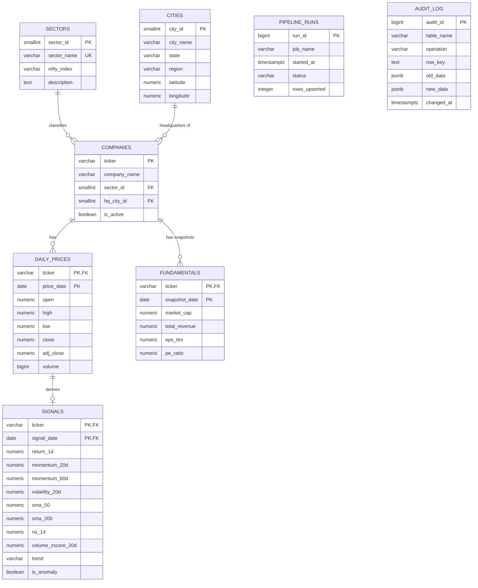

# ER Diagram

## Normalisation notes

- **3NF**: sector and city attributes live in their own tables; `companies` only stores foreign keys, so a city's coordinates or a sector's index name is stored exactly once.
- `daily_prices` and `signals` share the composite key `(ticker, date)`. `signals` has a composite foreign key to `daily_prices`, so a signal can never exist without its price row.
- `fundamentals` uses `(ticker, snapshot_date)` so repeated snapshots build a history instead of overwriting.
- `audit_log` is filled only by triggers (`trg_audit`), so every change to companies, fundamentals and price corrections is traceable.
- `pipeline_runs` is a standalone audit/log table (no FKs) used for pipeline monitoring.

## Constraints used

| Kind | Where |
|---|---|
| CHECK | `close > 0`, `high >= low`, `volume >= 0`, `region IN (...)`, lat/long ranges, `trend IN (...)`, `status IN (...)` |
| UNIQUE | `sectors.sector_name`, `cities(city_name, state)` |
| ON DELETE CASCADE | `signals → daily_prices` |
| Partial index | `idx_signals_anomaly ... WHERE is_anomaly` |
