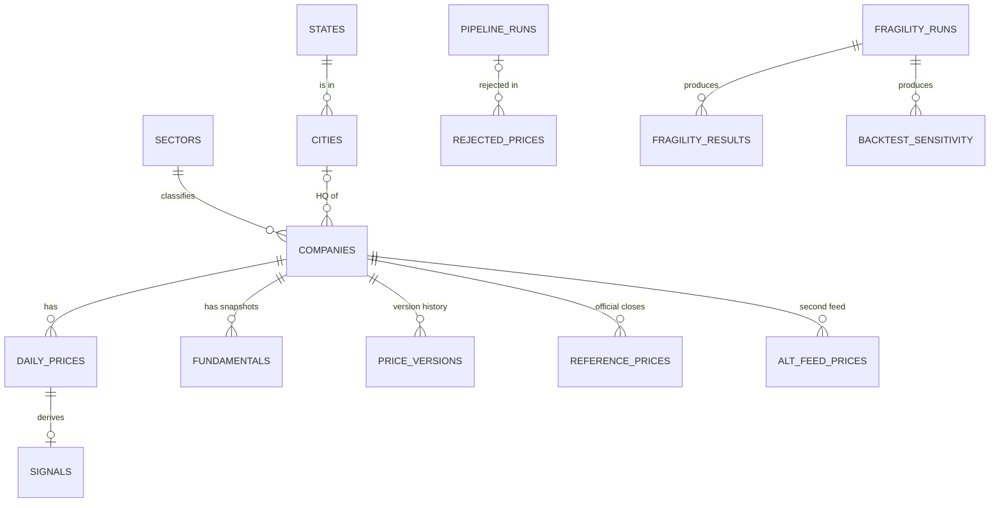

# Database schema reference

PostgreSQL 15+ (production: PostgreSQL 17 on Neon). Created by the files in `sql/`, applied in name order by
`src/setup_db.py`. Every file is idempotent and re-runs before each load.

Conventions: prices are `NUMERIC(14,4)` (exact decimal, no float rounding); timestamps are `TIMESTAMPTZ` (stored in UTC,
shown in IST by the client); `ticker` is the Yahoo symbol (`INFY.NS`), always upper case.

- [Core model](#core-model): `sectors`, `states`, `cities`, `companies`, `daily_prices`, `signals`, `fundamentals`
- [Operations](#operations): `pipeline_runs`, `audit_log`, `market_holidays`, `rejected_prices`
- [Data-trust research layer](#data-trust-research-layer): `price_versions`, `reference_prices`, `reference_fetch_log`,
  `alt_feed_prices`, `fragility_runs`, `fragility_results`, `backtest_sensitivity`
- [Views](#views), [functions and procedures](#functions-procedures-and-triggers), [roles](#roles)

## Core model

### `sectors` (`sql/01_schema.sql`)
One row per sector. The 5 dashboard sectors are seeded in `02_seed.sql`. `src/universe.py` adds the NSE industry names
of the research stocks.

| Column | Type | Null | Meaning |
|---|---|---|---|
| `sector_id` | SMALLSERIAL | PK | surrogate key |
| `sector_name` | VARCHAR(50) | NOT NULL, UNIQUE | `IT`, `Banking`, `Auto`, `Pharma`, `FMCG` (natural key) |
| `nifty_index` | VARCHAR(50) | yes | the NSE sector index, e.g. `NIFTY IT` |
| `description` | TEXT | yes | free text |

### `states` (`sql/12_integrity_and_reporting.sql`)
Holds the dependency `state → region` once (3NF fix; see [MIGRATION_NOTES.md](MIGRATION_NOTES.md)).

| Column | Type | Null | Meaning |
|---|---|---|---|
| `state` | VARCHAR(60) | PK | Indian state or union territory |
| `region` | VARCHAR(10) | NOT NULL, CHECK in (North, South, East, West, Central) | the state's region; `UNIQUE (state, region)` is the target of the cities FK |

### `cities`
Headquarters locations for the Power BI map.

| Column | Type | Null | Meaning |
|---|---|---|---|
| `city_id` | SMALLSERIAL | PK | surrogate key |
| `city_name` | VARCHAR(60) | NOT NULL | e.g. `Bengaluru` |
| `state` | VARCHAR(60) | NOT NULL | `UNIQUE (city_name, state)` is the natural key |
| `region` | VARCHAR(10) | NOT NULL, CHECK | kept for read convenience; FK `(state, region) → states` (deferred) keeps it consistent |
| `latitude` | NUMERIC(9,6) | NOT NULL, CHECK −90..90 | city-centre coordinates |
| `longitude` | NUMERIC(9,6) | NOT NULL, CHECK −180..180 | |

### `companies`
One row per listed stock: the 25 dashboard stocks and the research universe.

| Column | Type | Null | Meaning |
|---|---|---|---|
| `ticker` | VARCHAR(20) | PK, CHECK upper case | Yahoo symbol, e.g. `HDFCBANK.NS` |
| `company_name` | VARCHAR(120) | NOT NULL | |
| `sector_id` | SMALLINT | NOT NULL, FK → `sectors` | total participation: every stock has a sector |
| `hq_city_id` | SMALLINT | yes, FK → `cities` | NULL for research-only stocks (not on the map) |
| `is_active` | BOOLEAN | NOT NULL, default TRUE | FALSE instead of DELETE, so history is kept (see `replace_company()`) |
| `added_at` | TIMESTAMPTZ | NOT NULL, default now() | |
| `in_dashboard` | BOOLEAN | NOT NULL, default TRUE | FALSE for research stocks; every reporting view filters on it |
| `cap_group` | VARCHAR(8) | NOT NULL, CHECK `large`/`small` | for data-quality comparison by company size |
| `index_membership` | TEXT[] | NOT NULL, default `{}` | index lists the stock was taken from, e.g. `{NIFTY 50}` |
| `isin` | VARCHAR(12) | yes | exchange-independent id, used to match BSE files (`09_reconciliation.sql`) |

### `daily_prices`
The fact table: one end-of-day bar per stock per trading day. Weak entity of `companies`.

| Column | Type | Null | Meaning |
|---|---|---|---|
| `ticker` | VARCHAR(20) | PK, FK → `companies` ON UPDATE CASCADE | |
| `price_date` | DATE | PK, CHECK ≥ 1990-01-01 | trading session (IST date); future dates blocked by the `validate_price` trigger |
| `open`, `high`, `low` | NUMERIC(14,4) | yes, CHECK > 0 | CHECK `high >= low` |
| `close` | NUMERIC(14,4) | NOT NULL, CHECK > 0 | Yahoo close (split-adjusted, not dividend-adjusted) |
| `adj_close` | NUMERIC(14,4) | yes, CHECK > 0 | split- and dividend-adjusted close; **all signals use it** (`COALESCE(adj_close, close)`) |
| `volume` | BIGINT | yes, CHECK ≥ 0 | shares traded |
| `loaded_at` | TIMESTAMPTZ | NOT NULL, default now() | last time the row's values changed |
| `source` | VARCHAR(24) | NOT NULL, CHECK `yahoo_daily`/`yahoo_hourly` | provenance: Yahoo's daily candle, or a gap rebuilt from hourly bars (approximate, insert-only) |

Indexes: PK `(ticker, price_date)` (per-stock ranges and latest row); `idx_daily_prices_date (price_date)` (cross-sectional
"all stocks on day X").

### `signals`
Derived values, one row per price row, computed in SQL by `refresh_signals()`. Composite PK = composite FK to
`daily_prices(ticker, price_date)` ON DELETE CASCADE, so no signal can exist without its price.

| Column | Type | Meaning |
|---|---|---|
| `ticker`, `signal_date` | VARCHAR(20), DATE | PK and FK |
| `return_1d` | NUMERIC(10,6) | `px / px[-1] − 1` (fraction) |
| `momentum_20d`, `momentum_60d` | NUMERIC(10,6) | 20 / 60-session return |
| `volatility_20d` | NUMERIC(10,6), CHECK ≥ 0 | sample st. dev. of the last 20 daily returns × √252 |
| `sma_50` | NUMERIC(14,4) | mean of the last 50 prices (fewer at the start of history) |
| `sma_200` | NUMERIC(14,4) | mean of the last 200 prices; NULL until 200 exist |
| `rsi_14` | NUMERIC(6,2), CHECK 0..100 | simple-average RSI over 14 price changes; 50 if flat, 100 if no losses |
| `volume_zscore_20d` | NUMERIC(10,4) | (today's volume − mean of previous 20) / st. dev. of previous 20 |
| `trend` | VARCHAR(10), CHECK UP/DOWN/NEUTRAL | UP if px > SMA50 > SMA200, DOWN if px < SMA50 < SMA200 |
| `is_anomaly` | BOOLEAN NOT NULL | \|return\| > 3 × st. dev. of the previous 20 returns, or volume z > 3 |
| `anomaly_reason` | VARCHAR(40) | `price_spike`, `volume_spike`, `price_and_volume_spike`; CHECK: NOT NULL exactly when `is_anomaly` |
| `computed_at` | TIMESTAMPTZ | last recomputation |
| `high_52w` | NUMERIC(12,2) | max `adj_close` of the **previous** 252 sessions (today excluded); NULL until 252 exist |
| `breakout_52w` | BOOLEAN | `adj_close > high_52w` |
| `pct_from_52w_high` | NUMERIC(8,2) | `(adj_close / high_52w − 1) × 100` |
| `strong_breakout` | BOOLEAN | breakout and `volume_zscore_20d > 2` |

Indexes: `idx_signals_date`, partial `idx_signals_anomaly (signal_date) WHERE is_anomaly`, partial
`idx_signals_breakout (signal_date) WHERE breakout_52w`.

### `fundamentals`
Weekly dated snapshots (Yahoo only gives current values, so history accumulates).

| Column | Type | Meaning |
|---|---|---|
| `ticker` | VARCHAR(20), PK, FK → `companies` | |
| `snapshot_date` | DATE, PK, default CURRENT_DATE | |
| `market_cap` | NUMERIC(20,2), CHECK ≥ 0 | ₹ |
| `total_revenue` | NUMERIC(20,2) | ₹, trailing |
| `eps_ttm` | NUMERIC(12,4) | can be negative |
| `pe_ratio`, `price_to_book` | NUMERIC(12,4) | |
| `dividend_yield` | NUMERIC(8,4), CHECK ≥ 0 | units changed upstream in 2025 (fraction → percent), see AUDIT.md #13 |

## Operations

### `pipeline_runs`
One row per job execution, written by `db.pipeline_run()`.

| Column | Type | Meaning |
|---|---|---|
| `run_id` | BIGSERIAL PK | also used as provenance id in `price_versions` |
| `job_name` | VARCHAR(40) | `daily_update`, `backfill`, `data_quality`, `fundamentals`, `revision_scan`, `alt_feed`, `universe`, … |
| `started_at`, `finished_at` | TIMESTAMPTZ | CHECK `finished_at >= started_at` |
| `status` | VARCHAR(10), CHECK | `running`, `success`, `partial` (some tickers failed), `failed` |
| `rows_upserted` | INTEGER ≥ 0 | rows actually written (unchanged rows are not counted) |
| `tickers_failed` | TEXT[] | failed tickers, or failed check names for `data_quality` |
| `message` | TEXT | human-readable summary, including validation rejections |

### `audit_log` (`05_audit_and_procedures.sql`)
Written by triggers: inserts/deletes/real changes on `companies` and `fundamentals`, corrections and deletions on
`daily_prices` (not normal inserts, not adj_close-only rescaling).

| Column | Type | Meaning |
|---|---|---|
| `audit_id` | BIGSERIAL PK | |
| `table_name` | VARCHAR(40) | audited table |
| `operation` | VARCHAR(10), CHECK | INSERT / UPDATE / DELETE |
| `row_key` | TEXT | `TICKER` or `TICKER|DATE` |
| `old_data`, `new_data` | JSONB | full row before / after |
| `changed_by` | TEXT | `current_user` |
| `changed_at` | TIMESTAMPTZ | |

### `market_holidays` (`07_trading_calendar.sql`)
NSE trading holidays (weekdays only). Drives `is_trading_day()` and the freshness checks. **Currently 2026 only**:
add the 2027 list in December.

| Column | Type | Meaning |
|---|---|---|
| `holiday_date` | DATE PK | |
| `occasion` | TEXT | e.g. `Diwali - Balipratipada` |

### `rejected_prices` (`12_integrity_and_reporting.sql`)
Rows refused by `src/validation.py` before insert.

| Column | Type | Meaning |
|---|---|---|
| `rejection_id` | BIGSERIAL PK | |
| `run_id` | BIGINT, FK → `pipeline_runs` ON DELETE SET NULL | the job that rejected it |
| `ticker` | VARCHAR(20) | |
| `price_date` | DATE | NULL for malformed rows |
| `check_name` | VARCHAR(40) | `missing_value`, `non_positive_price`, `negative_volume`, `high_below_low`, `duplicate_ticker_date`, `price_spike`, `malformed_row` |
| `detail` | TEXT | e.g. `+50.0% then -32.0% next session (isolated spike)` |
| `raw_row` | JSONB | the row as received |
| `rejected_at` | TIMESTAMPTZ | |

## Data-trust research layer

### `price_versions` (`08_point_in_time.sql`)
Bitemporal history of `daily_prices`, filled by the `trg_price_versioning` trigger. Nothing is overwritten.

| Column | Type | Meaning |
|---|---|---|
| `version_id` | BIGSERIAL PK | |
| `ticker` | VARCHAR(20), FK → `companies` | |
| `price_date` | DATE | valid time |
| `open` … `volume`, `source` | as `daily_prices` | the values of this version |
| `sys_from` | TIMESTAMPTZ NOT NULL | transaction time: version became current |
| `sys_to` | TIMESTAMPTZ | NULL = current; CHECK `sys_to > sys_from` |
| `run_id` | BIGINT | pipeline run that wrote it (from `app.run_id`) |
| `origin` | VARCHAR(12), CHECK | `trigger`, `seed`, `audit_log` |

Integrity: partial unique index (one current version per stock-day); GiST exclusion constraint (versions of one
stock-day never overlap in time).

### `reference_prices` (`09_reconciliation.sql`)
Official NSE/BSE closing prices (bhavcopy), used to measure Yahoo's accuracy.

| Column | Type | Meaning |
|---|---|---|
| `source` | VARCHAR(8), PK, CHECK NSE/BSE | |
| `ticker` | VARCHAR(20), PK, FK → `companies` | |
| `price_date` | DATE, PK | |
| `open`, `high`, `low` | NUMERIC(14,4) | CHECK `high >= low` |
| `close` | NUMERIC(14,4), CHECK > 0 | official close |
| `last_price`, `prev_close` | NUMERIC(14,4) | last traded / previous close |
| `volume`, `n_trades` | BIGINT | |
| `isin` | VARCHAR(12) | |
| `fetched_at`, `run_id` | | provenance |

### `reference_fetch_log`
One row per attempted official-file download: PK `(source, file_date)`; `status` (`ok`, `not_published`, `blocked`,
`error`), `http_status`, `rows_matched`, `detail`, `fetched_at`.

### `alt_feed_prices` (`11_research.sql`)
Second free feed (Yahoo's BSE listing). PK `(feed, ticker, price_date)`; `close` (CHECK > 0), `adj_close`, `volume`;
`first_close` / `first_seen` (first print), `last_changed`, `n_changes` (later revisions), `run_id`.

### `fragility_runs`, `fragility_results`, `backtest_sensitivity` (`10_trust.sql`)
Output of `src/fragility.py` (how often simulated data errors flip each signal).
- `fragility_runs`: `frag_run_id` PK, `created_at`, `run_id`, `data_through`, `n_stock_days`, `seed`, `params` JSONB,
  `validation` JSONB (how exactly the Python replica matches SQL), `notes`.
- `fragility_results`: PK `(frag_run_id, universe, scenario, signal)`; `n_compared`, `n_flipped` (CHECK
  `n_flipped <= n_compared`), `flip_rate`, Wilson `ci_low`/`ci_high`, bootstrap `boot_low`/`boot_high`.
- `backtest_sensitivity`: PK `(frag_run_id, scenario, metric)`, `value`.

## Views

| View | File | Grain / purpose |
|---|---|---|
| `v_company_daily` | 04 | price + signals + sector + location per stock-day (dashboard stocks) |
| `v_latest_snapshot` | 04 | latest `v_company_daily` row per stock |
| `v_sector_daily` | 04 | equal-weighted sector averages per day, breakout counts |
| `mv_sector_daily` | 06 | materialized copy of `v_sector_daily`, refreshed `CONCURRENTLY` after each load |
| `v_sector_strength` | 04 | sector 20-day momentum relative to the universe, ranked |
| `v_region_daily` | 04 | per region/state per day |
| `v_anomalies` | 04 | all anomaly rows, newest first |
| `v_pipeline_health` | 04 | last run of each job + latest price date |
| `v_recent_changes` | 05 | last 200 audit entries |
| `v_data_freshness` | 07 | per stock: latest date vs expected trading day |
| `v_price_revisions`, `v_settlement`, `v_revision_summary` | 08 | every Yahoo revision, classified |
| `v_source_agreement*`, `v_consensus_close`, `v_reference_coverage` | 09 | Yahoo vs official closes |
| `v_price_trust`, `v_latest_trust`, `v_trust_summary`, `v_fragility_latest` | 10 | per-row trust score, fragility |
| `v_feed_agreement`, `v_quality_by_group` | 11 | second feed, quality by company size |
| `v_latest_prices_by_sector` | 12 | **Power BI**: one row per active dashboard stock, day change, rank in sector |
| `v_sector_daily_performance` | 12 | **Power BI**: per sector per day, advancers/decliners, best/worst, turnover, index = 100 |
| `v_sector_returns_summary` | 12 | **Power BI**: per sector, 1D/1W/1M/3M/YTD % |
| `v_rejections_summary` | 12 | validation rejections per day and check |

## Functions, procedures and triggers

| Object | Kind | Purpose |
|---|---|---|
| `refresh_signals(p_from DATE)` | PL/pgSQL function | recomputes signals from `p_from` with window functions and `INSERT … ON CONFLICT`; 52-week columns over full history |
| `is_trading_day(d)`, `expected_latest_trading_day(ts)` | SQL / PL/pgSQL | NSE calendar logic (16:30 IST cut-off) |
| `prices_as_of(ts)`, `price_history(ticker, date)` | SQL functions | time travel over `price_versions` |
| `session_final_at(d)`, `classify_revision(...)` | functions | revision taxonomy |
| `replace_company(old, new, name)` | procedure | atomic ticker replacement with row lock |
| `trg_audit` | trigger function | `audit_log` |
| `trg_validate_price` | BEFORE trigger | upper-cases ticker, blocks future dates |
| `trg_price_versioning` | AFTER trigger | writes `price_versions` |

## Roles

`readonly_access` (NOLOGIN group role): `USAGE` on schema `public`, `SELECT` on all tables and views (also future ones,
through default privileges), `EXECUTE` on the time-travel functions. Login users such as `powerbi_reader` are made
members of it.
